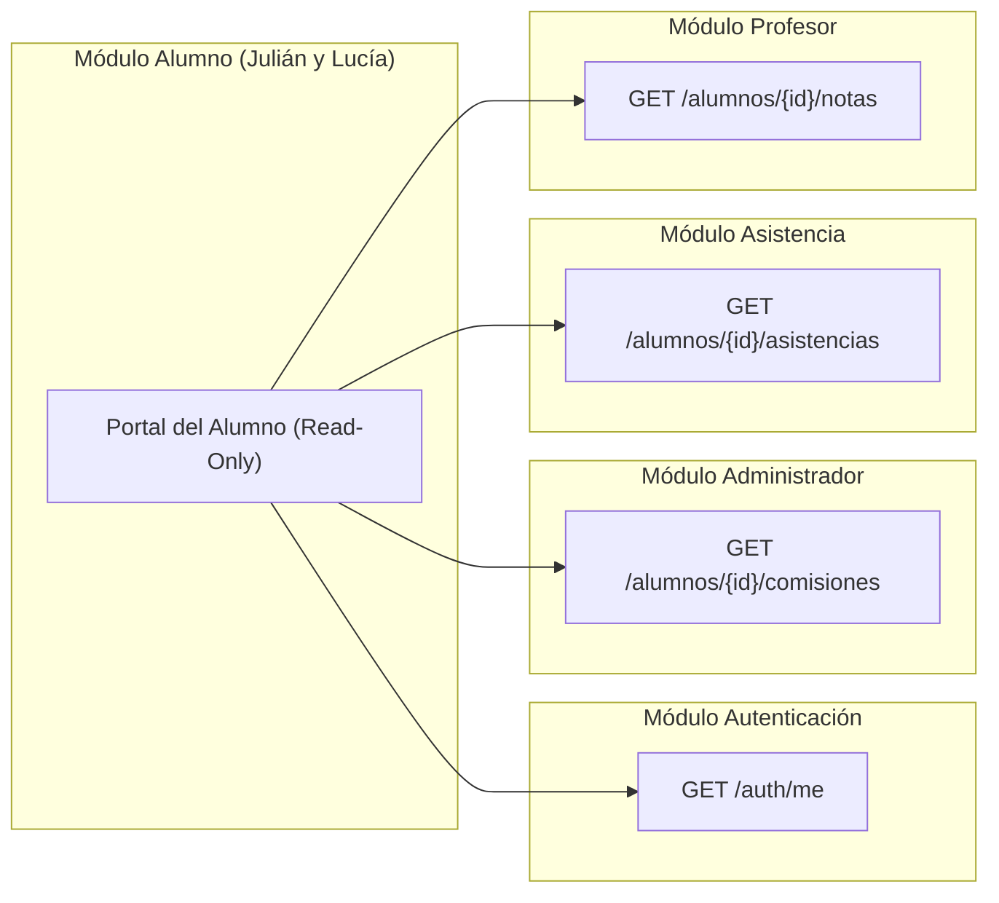

# Módulo Alumno — Sistema de Gestión Académica

> **Autores:** Julián y Lucía  
> **Proyecto:** Sistema de Gestión Académica — Alcance de Entrega y Arquitectura del Módulo Alumno  
> **Estado:** Especificación de Alcance y Diseño de Arquitectura (MVP)  

[](#)
[](#)
[](#)
[](#)

---

## 📌 Visión General

El **Módulo Alumno** forma parte del *Sistema de Gestión Académica* distribuido. Su objetivo principal es proveer al estudiante un portal autocontenido, intuitivo y seguro para consultar su estado académico, historial de asistencia, asignación de materias/comisiones y libreta digital de calificaciones.

Este módulo ha sido diseñado bajo un paradigma estricto de **Solo Lectura (Read-Only)** y **Aislamiento de Datos por Alumno (Row-Level Isolation)**. No crea ni gestiona datos maestros, sino que consume de forma eficiente la información estructurada producida por los módulos centrales (Autenticación, Administración, Asistencia y Profesor).

> [!NOTE]
> Para ver el **documento visual interactivo** con el diseño editorial de especificación de producto, abre en tu navegador el archivo [`index.html`](index.html).

---

## 📁 Estructura del Repositorio de Documentación y Sistema

```text
modulo_alumnos/
├── 🌟 portal_definitivo/                # 👑 CARPETA DEL PORTAL ALUMNO DEFINITIVO (AI STUDIO + SLATE)
│   ├── index.html                      # Aplicación web definitiva del estudiante (Gemini AI + Dashboard)
│   ├── styles.css                      # Sistema de diseño Slate & Studio
│   └── app.js                          # Lógica interactiva, chat Gemini IA y servicio de APIs
├── README.md                           # Visión general y guía principal del repositorio
├── portal_alumno.html                  # Portal web interactivo básico
├── app.css                             # Estilos del sistema de diseño Slate
├── app.js                              # Lógica de aplicación
├── index.html                          # Especificación visual del alcance MVP (Editorial HTML)
├── index_detalle.html                  # Especificación técnica detallada por sección y tecnologías
├── index_conexiones.html               # Mapa de conexiones e integraciones con módulos externos
└── docs/
    ├── ALCANCE_MVP.md                  # Detalle funcional de las 7 características MVP y postergadas
    ├── ARQUITECTURA_E_INTEGRACIONES.md # Diagramas de secuencia, contrato de consumo de API y tablas BD
    └── ESTILOS_Y_DESIGN_SYSTEM.md      # Informe técnico del sistema de diseño editorial
```

* 👑 [**PORTAL ALUMNO DEFINITIVO (portal_definitivo/index.html)**](portal_definitivo/index.html)
* 🚀 [**Portal Interactivo Básico (portal_alumno.html)**](portal_alumno.html)
* 🌐 [**Vista Gráfica del Alcance MVP (index.html)**](index.html)
* ⚙️ [**Detalle Técnico por Sección y Tecnologías (index_detalle.html)**](index_detalle.html)
* 🔗 [**Mapa de Conexiones e Integraciones de API (index_conexiones.html)**](index_conexiones.html)

---

## 🏗️ Matriz de Responsabilidades entre Módulos

Para evitar duplicación de lógica y garantizar un desacoplamiento limpio, el sistema establece fronteras claras entre módulos:

| Módulo | Responsable | Lógica Principal | Alcance sobre los Datos |
| :--- | :--- | :--- | :--- |
| **Alumno** | **Julián y Lucía** | Portal de autogestión y consulta personal del estudiante. | **Solo Lectura** (Filtrado por `alumno_id`). |
| **Profesor** | Equipo Docente | Registro de notas de evaluaciones, parciales y cursada. | Escritura en `calificaciones`, Lectura en `comisiones`. |
| **Preceptores / Asistencia** | Equipo Asistencia | Toma de asistencia diaria, cómputo de faltas y alertas. | Escritura en `asistencias` e `inasistencias`. |
| **Administración / Auth** | Equipo Central | Gestión de usuarios, legajos, asignación a comisiones y login. | Escritura en `usuarios`, `alumnos`, `comisiones`. |

---

## 🔄 Flujo Conceptual de Integración



---

## 🚀 Resumen del Alcance del MVP

El MVP del Módulo Alumno abarca **7 funcionalidades clave** organizadas en 4 secciones funcionales:

1. **01 Acceso y contexto**: Iniciar sesión con rol alumno (`usuarios`), Ver perfil académico (`alumnos`).
2. **02 Materias y comisiones**: Mis materias asignadas (`alumno_comision`), Detalle de comisión y docentes (`comisiones`).
3. **03 Asistencia**: Historial de asistencia por materia (`asistencias`), Porcentaje de asistencia acumulado (`asistencias`).
4. **04 Calificaciones**: Libreta digital de notas y condición final (`calificaciones`).

> [!IMPORTANT]
> **Fuera del MVP**: Inscripción online a materias, justificación de inasistencias con certificados, emisión en PDF de certificado de alumno regular y reclamo formal de notas.

---

## 🔒 Reglas Principales y Seguridad

1. **Aislamiento de Información**: El alumno logueado únicamente puede consultar datos pertenecientes a su `alumno_id` o `usuario_id`. Imposibilidad técnica de acceder a registros de otros compañeros.
2. **Cero Lógica de Modificación**: No existen formularios ni botones de edición en el módulo. Toda actualización de datos proviene de los módulos originadores.
3. **Reutilización BD Maestras**: El módulo no requiere esquemas de datos propios ni tablas duplicadas.

---

## 📚 Enlaces a Documentación Detallada

* 📄 [**Alcance Funcional y Historias de Usuario (ALCANCE_MVP.md)**](docs/ALCANCE_MVP.md)
* 📐 [**Arquitectura, Integraciones y Esquema BD (ARQUITECTURA_E_INTEGRACIONES.md)**](docs/ARQUITECTURA_E_INTEGRACIONES.md)
* 🎨 [**Informe Técnico del Design System (ESTILOS_Y_DESIGN_SYSTEM.md)**](docs/ESTILOS_Y_DESIGN_SYSTEM.md)
* 🌐 [**Vista Gráfica Interactiva (index.html)**](index.html)
