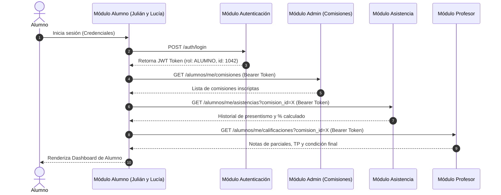

# Arquitectura e Integraciones — Módulo Alumno

> **Proyecto:** Sistema de Gestión Académica — Módulo Alumno  
> **Integrantes:** Julián y Lucía  

---

## 🏛️ Principios de Arquitectura

El Módulo Alumno fue concebido bajo tres pilares fundamentales de arquitectura de software:

1. **Desacoplamiento Estricto:** El módulo no administra base de datos ni lógica de modificación propia. Se acopla a los servicios existentes únicamente a través de contratos de API bien definidos.
2. **Read-Only / Consume-Only Pattern:** Toda llamada a la capa de datos es de consulta de lectura (`GET`). No existen llamadas a mutaciones (`POST`, `PUT`, `DELETE`) en el alcance del alumno.
3. **Seguridad y Aislamiento por Token (JWT Context):** La identidad del alumno se valida mediante el token de autenticación central. Todas las consultas filtran automáticamente por el `alumno_id` extraído del token en el backend.

---

## 🔄 Diagrama de Secuencia de Integración

El siguiente diagrama ilustra cómo interactúa el Módulo Alumno con los componentes centrales del sistema:



---

## 🔌 Contratos de Consumo de API

El Módulo Alumno requiere que los demás integrantes del sistema expongan los siguientes endpoints de consulta:

### 1. Autenticación (`Auth`)
* **Endpoint:** `GET /auth/me`
* **Headers:** `Authorization: Bearer <token>`
* **Respuesta Esperada:**
  ```json
  {
    "usuario_id": 45,
    "alumno_id": 1042,
    "nombre": "Julián",
    "apellido": "Pérez",
    "email": "julian.perez@alumnos.edu.ar",
    "rol": "ALUMNO"
  }
  ```

### 2. Comisiones e Inscripciones (`Admin / Cursadas`)
* **Endpoint:** `GET /alumnos/{alumno_id}/comisiones`
* **Respuesta Esperada:**
  ```json
  [
    {
      "comision_id": 12,
      "materia": "Programación II",
      "cuatrimestre": "2026-1C",
      "horario": "Lunes y Miércoles 18:00 - 22:00",
      "aula": "Aula 204 - Sede Central",
      "profesores": ["Lic. Martín Gómez", "Ing. Laura Ríos"]
    }
  ]
  ```

### 3. Asistencia (`Módulo Asistencia / Preceptores`)
* **Endpoint:** `GET /alumnos/{alumno_id}/asistencias?comision_id=12`
* **Respuesta Esperada:**
  ```json
  {
    "comision_id": 12,
    "total_clases": 16,
    "asistencias": 14,
    "inasistencias": 2,
    "porcentaje_asistencia": 87.5,
    "estado_regularidad": "REGULAR",
    "detalles": [
      { "fecha": "2026-08-10", "estado": "PRESENTE" },
      { "fecha": "2026-08-12", "estado": "AUSENTE" }
    ]
  }
  ```

### 4. Calificaciones (`Módulo Profesor`)
* **Endpoint:** `GET /alumnos/{alumno_id}/calificaciones?comision_id=12`
* **Respuesta Esperada:**
  ```json
  {
    "comision_id": 12,
    "materia": "Programación II",
    "evaluaciones": [
      { "instancia": "Primer Parcial", "nota": 8, "fecha": "2026-09-05" },
      { "instancia": "Trabajo Práctico 1", "nota": 10, "fecha": "2026-09-15" }
    ],
    "condicion_final": "EN_CURSADA"
  }
  ```

---

## 🗄️ Reutilización de Tablas de la Base de Datos

Para cumplir con la directiva de **no duplicar tablas**, el Módulo Alumno consulta el siguiente modelo entidad-relación existente:

```text
  [usuarios] (id, email, password, rol)
      │
      └── [alumnos] (id, usuario_id, legajo, dni, carrera_id, estado)
              │
              ├── [alumno_comision] (alumno_id, comision_id)
              │       │
              │       └── [comisiones] (id, materia_id, aula, horario)
              │
              ├── [asistencias] (id, alumno_id, comision_id, fecha, estado)
              │
              └── [calificaciones] (id, alumno_id, comision_id, instancia, nota)
```

---

## 🔒 Requisitos No Funcionales de Seguridad

* **Row-Level Security (RLS):** Toda query ejecutada por la API verifica que `WHERE alumno_id = :current_user_alumno_id`.
* **Caché Eficiente:** Para evitar sobrecargar la BD con consultas de la misma libreta de notas, los endpoints de consulta de calificaciones y comisiones pueden utilizar una memoria caché de corto tiempo (ej. 5 minutos).
