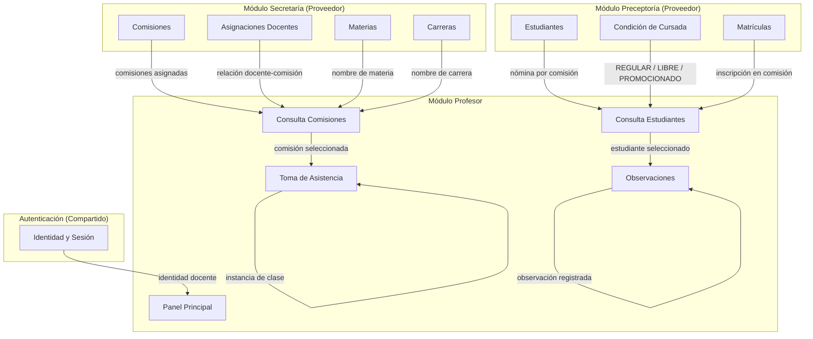
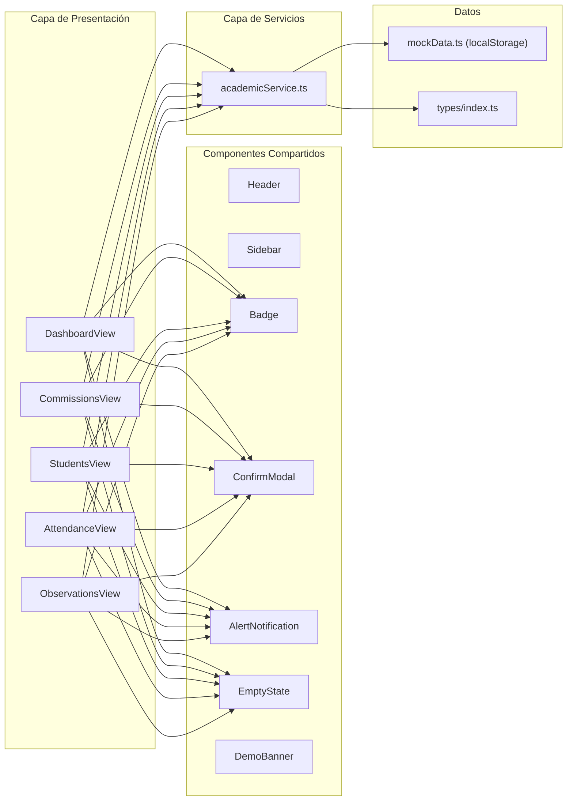

# 01 — Alcance y Arquitectura del Módulo Profesor

> **Versión del contrato:** 0.1.0 (Propuesta inicial)
> **Fecha de redacción:** 2026-10-16
> **Estado:** Propuesta técnica — pendiente de revisión grupal
> **Fuente de evidencia:** Código fuente del frontend en `src/` (React 19, TypeScript, Vite)

---

## 1. Propósito

Este documento define el alcance funcional, los límites de responsabilidad y la arquitectura de integración del **Módulo Profesor** dentro del Sistema de Gestión Académica (SGA) del ISFDyT N.° 26.

Su objetivo es servir como contrato compartido para que cada integrante del equipo conozca qué operaciones necesita el Módulo Profesor del backend, qué datos consume, qué datos produce y qué entidades pertenecen a otros módulos.

---

## 2. Alcance funcional del Módulo Profesor

### 2.1. Funcionalidades implementadas en el frontend

Las siguientes funcionalidades están operativas con datos simulados y requieren endpoints reales del backend.

| ID | Funcionalidad | Archivo fuente principal |
|----|---------------|--------------------------|
| F-01 | Panel principal (dashboard) con métricas del docente | `src/views/DashboardView.tsx` |
| F-02 | Consulta de comisiones y materias asignadas al docente | `src/views/CommissionsView.tsx` |
| F-03 | Listado de estudiantes por comisión con búsqueda, filtro y ordenamiento | `src/views/StudentsView.tsx` |
| F-04 | Toma de asistencia: creación o apertura de clase, asignación de estado (PRESENTE, AUSENTE, TARDE), validación y confirmación | `src/views/AttendanceView.tsx` |
| F-05 | Registro y consulta de observaciones académicas cualitativas con fecha pedagógica separada | `src/views/ObservationsView.tsx` |
| F-06 | Restablecimiento de datos de demostración (solo frontend) | `src/components/common/DemoBanner.tsx` |

### 2.2. Funcionalidades explícitamente excluidas

El frontend **no implementa** y el contrato **no incluye**:

- Creación, edición o eliminación de comisiones o materias (competencia de Secretaría Académica).
- Alta, baja o modificación administrativa de estudiantes (competencia de Preceptoría).
- Gestión de usuarios, roles o permisos del sistema.
- Autenticación de producción (la identidad del docente es fija en `mockData.ts`).
- Calificaciones numéricas, actas de exámenes ni promedios.
- Justificaciones de inasistencia, sanciones o reglas de regularidad académica.
- Adjuntos, archivos multimedia o firmas digitales.
- Módulos de Dirección, Preceptoría, Secretaría u otros.

---

## 3. Actores del sistema

| Actor | Rol en el SGA | Relación con el Módulo Profesor |
|-------|---------------|-------------------------------|
| **Docente** | Usuario principal del módulo. Consulta sus comisiones, registra asistencia y observaciones. | Actor directo — todas las operaciones del contrato se ejecutan en nombre de un docente autenticado. |
| **Preceptor/a** | Administra matrículas, condiciones de cursada y nómina de estudiantes. | Proveedor de datos — el módulo docente **consume** la nómina pero no la modifica. |
| **Secretaría Académica** | Crea carreras, materias, comisiones y asigna docentes a cátedras. | Proveedor de datos — el módulo docente **consume** las asignaciones pero no las crea. |
| **Dirección** | Supervisa informes y configuraciones globales. | Sin interacción directa en esta versión del módulo. |
| **Estudiante** | Sujeto de seguimiento académico. | No tiene acceso al módulo docente; sus datos se consultan por referencia. |

---

## 4. Responsabilidades por capa

### 4.1. Frontend (Módulo Profesor — este proyecto)

- Presentar la interfaz de usuario accesible y responsive.
- Validar entradas en el cliente (campos obligatorios, longitud mínima, estado asignado a cada estudiante).
- Invocar la API REST del backend mediante la capa de servicios (`academicService.ts`).
- Manejar estados de carga, éxito, error y vacío.
- No almacenar tokens ni contraseñas de forma insegura.

### 4.2. Backend (por desarrollar)

- Autenticar y autorizar al docente en cada petición.
- Validar **todas** las entradas en el servidor (las validaciones del frontend son UX, no seguridad).
- Verificar que el docente solo acceda a las comisiones que tiene asignadas.
- Persistir asistencias y observaciones de forma transaccional.
- Exponer una API REST versionada con respuestas JSON uniformes.
- Registrar auditoría de operaciones relevantes.

### 4.3. Base de datos (por definir)

- Garantizar integridad referencial entre entidades.
- Impedir registros duplicados de asistencia (un estudiante por instancia de clase).
- Almacenar timestamps con zona horaria.
- Proteger datos personales sensibles (DNI, contacto).

---

## 5. Dependencias entre módulos del SGA

### 5.1. Datos que el Módulo Profesor consume (lectura)

| Dato | Módulo propietario | Interfaz esperada |
|------|--------------------|-------------------|
| Identidad del docente autenticado | Autenticación | Endpoint de sesión o token |
| Carreras (nombre, tipo de título) | Secretaría | API o vista de base de datos |
| Materias (nombre, código, año) | Secretaría | API o vista de base de datos |
| Comisiones (turno, horario, aula) | Secretaría | API o vista de base de datos |
| Asignación docente-comisión | Secretaría | Tabla relacional compartida |
| Estudiantes (legajo, DNI, nombre) | Preceptoría | API o vista de base de datos |
| Inscripción estudiante-comisión | Preceptoría | Tabla relacional compartida |
| Condición del estudiante (REGULAR, LIBRE, PROMOCIONADO) | Preceptoría | Campo en inscripción |

### 5.2. Datos que el Módulo Profesor produce (escritura)

| Dato | Operación | Propiedad |
|------|-----------|-----------|
| Instancias de clase (sesiones) | Crear / Consultar | **Módulo Profesor** |
| Registros de asistencia | Crear / Actualizar / Consultar | **Módulo Profesor** |
| Observaciones académicas | Crear / Consultar | **Módulo Profesor** |

---

## 6. Diagrama de componentes del frontend

---

## 7. Supuestos confirmados por el código

| # | Supuesto | Evidencia |
|---|----------|-----------|
| S-01 | El docente solo consulta sus propias comisiones (filtro por `teacherId`). | `academicService.ts` línea 84-86: `filter((c) => c.teacherId === teacherId)` |
| S-02 | Los estudiantes se obtienen por `commissionId`, no globalmente. | `academicService.ts` línea 111: `filter((s) => s.commissionId === commissionId)` |
| S-03 | La asistencia requiere los tres estados explícitos: PRESENTE, AUSENTE, TARDE. | `types/index.ts` línea 11: `type AttendanceStatus = 'PRESENTE' \| 'AUSENTE' \| 'TARDE'` |
| S-04 | No se asigna automáticamente el estado PRESENTE a ningún estudiante. | `AttendanceView.tsx` línea 42-43 y 89-92: inicialización con `null` |
| S-05 | La confirmación de asistencia requiere que **todos** los estudiantes tengan estado. | `AttendanceView.tsx` línea 200-205: validación de `summary.isComplete` |
| S-06 | Al guardar asistencia, los registros previos de la misma sesión se reemplazan completamente. | `academicService.ts` línea 215: `filter((r) => r.classSessionId !== sessionId)` |
| S-07 | Una instancia de clase es única por comisión y fecha. | `academicService.ts` línea 175: verificación de existencia antes de crear |
| S-08 | Las observaciones son cualitativas, sin notas numéricas ni promedios. | `ObservationsView.tsx`: no existe campo numérico; validación de texto ≥ 15 caracteres |
| S-09 | La fecha pedagógica y la fecha de registro (`createdAt`) son campos independientes. | `types/index.ts` líneas 90-91 |
| S-10 | La condición del estudiante (REGULAR, LIBRE, PROMOCIONADO) proviene del dato de inscripción, no del módulo docente. | `types/index.ts` línea 9; el frontend no permite modificarla |

---

## 8. Decisiones pendientes de acuerdo grupal

Las siguientes decisiones **no están resueltas** en el código fuente y requieren coordinación con el equipo antes de implementar el backend. Se detallan en `07-acuerdos-pendientes.md`.

| Ref. | Tema | Impacto |
|------|------|---------|
| AP-01 | Tecnología del backend (lenguaje, framework) | Determina la implementación de todos los endpoints |
| AP-02 | Motor de base de datos | Esquema físico y migraciones |
| AP-03 | Sistema de autenticación | Todas las peticiones autenticadas |
| AP-04 | Identificadores compartidos (formato UUID vs. numérico) | Compatibilidad entre módulos |
| AP-05 | ¿Puede el docente modificar una asistencia ya cerrada? | Lógica de `saveAttendance` y auditoría |
| AP-06 | ¿Puede el docente editar o eliminar una observación registrada? | El frontend no lo implementa actualmente |
| AP-07 | ¿Quién crea las instancias de clase: el docente o Secretaría? | El frontend permite crearlas (`createOrOpenClassSession`) |
| AP-08 | Política de CORS y dominio de despliegue | Configuración del servidor |

---

## 9. Principios de integración

1. **Propiedad de entidades:** Cada entidad tiene un único módulo propietario que controla su ciclo de vida. Los demás módulos consultan mediante API.
2. **Identificadores estables:** Las entidades compartidas deben usar identificadores persistentes acordados. El frontend actual usa `string` para todos los IDs.
3. **Contratos por interfaz:** Los módulos se comunican mediante contratos de API documentados, no mediante acceso directo a tablas de otros módulos.
4. **Validación en ambas capas:** Las validaciones del frontend mejoran la experiencia; las del backend garantizan integridad y seguridad.
5. **Datos desnormalizados solo en respuestas:** El frontend recibe datos consolidados (p. ej., `subjectName` dentro de `Commission`). Esto puede resolverse con JOINs o DTOs en el backend sin que la UI lo sepa.
6. **Sin dependencias circulares:** El Módulo Profesor depende de Autenticación, Secretaría y Preceptoría. Estos no dependen del Módulo Profesor.
