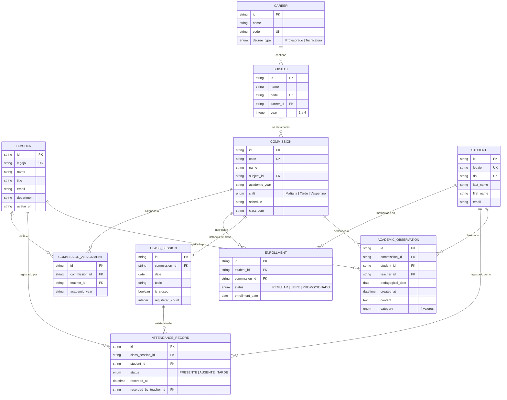

# 02 — Modelo de Datos del Módulo Profesor

> **Versión del contrato:** 0.1.0 (Propuesta inicial)
> **Fecha de redacción:** 2026-10-16
> **Estado:** Propuesta técnica — pendiente de revisión grupal
> **Fuente de evidencia:** `src/types/index.ts` y `src/data/mockData.ts`

---

## 1. Propósito

Definir el modelo de datos que el backend debe implementar para soportar todas las funcionalidades del Módulo Profesor. Las entidades se clasifican en:

- **Propias:** Creadas y gestionadas por el Módulo Profesor.
- **Compartidas (consumidas):** Gestionadas por otros módulos; el Módulo Profesor solo las consulta.

---

## 2. Diagrama Entidad-Relación



---

## 3. Detalle de entidades

### 3.1. Entidades compartidas (consumidas — propiedad de otros módulos)

#### Teacher (Docente)

> **Propietario:** Módulo de Autenticación / Recursos Humanos

| Campo | Tipo TS (`index.ts:13-21`) | Tipo SQL sugerido | Restricciones |
|-------|---------------------------|-------------------|---------------|
| `id` | `string` | `VARCHAR(36)` o `UUID` | PK |
| `legajo` | `string` | `VARCHAR(20)` | UNIQUE, NOT NULL |
| `name` | `string` | `VARCHAR(150)` | NOT NULL |
| `title` | `string` | `VARCHAR(200)` | NOT NULL |
| `email` | `string` | `VARCHAR(150)` | UNIQUE, NOT NULL, formato email |
| `department` | `string` | `VARCHAR(150)` | NOT NULL |
| `avatarUrl` | `string?` | `VARCHAR(500)` | NULLABLE |

**Observación del código:** El frontend obtiene un único docente fijo en `MOCK_TEACHER` (`mockData.ts:12-20`). El backend debe retornarlo según el token de sesión.

---

#### Career (Carrera)

> **Propietario:** Módulo Secretaría Académica

| Campo | Tipo TS (`index.ts:23-28`) | Tipo SQL sugerido | Restricciones |
|-------|---------------------------|-------------------|---------------|
| `id` | `string` | `VARCHAR(36)` | PK |
| `name` | `string` | `VARCHAR(200)` | NOT NULL |
| `code` | `string` | `VARCHAR(20)` | UNIQUE, NOT NULL |
| `degreeType` | `'Profesorado' \| 'Tecnicatura'` | `ENUM('Profesorado','Tecnicatura')` | NOT NULL |

**Observación del código:** El frontend no consume `Career` directamente; usa `careerName` dentro de `Commission` como dato desnormalizado.

---

#### Subject (Materia / Espacio Curricular)

> **Propietario:** Módulo Secretaría Académica

| Campo | Tipo TS (`index.ts:30-36`) | Tipo SQL sugerido | Restricciones |
|-------|---------------------------|-------------------|---------------|
| `id` | `string` | `VARCHAR(36)` | PK |
| `name` | `string` | `VARCHAR(200)` | NOT NULL |
| `code` | `string` | `VARCHAR(20)` | UNIQUE, NOT NULL |
| `careerId` | `string` | `VARCHAR(36)` | FK → `Career.id`, NOT NULL |
| `year` | `number` | `SMALLINT` | CHECK (1 ≤ year ≤ 4) |

**Observación del código:** El frontend no consume `Subject` directamente; usa `subjectId` y `subjectName` dentro de `Commission`.

---

#### Student (Estudiante)

> **Propietario:** Módulo Preceptoría

| Campo | Tipo TS (`index.ts:53-63`) | Tipo SQL sugerido | Restricciones |
|-------|---------------------------|-------------------|---------------|
| `id` | `string` | `VARCHAR(36)` | PK |
| `legajo` | `string` | `VARCHAR(20)` | UNIQUE, NOT NULL |
| `dni` | `string` | `VARCHAR(15)` | UNIQUE, NOT NULL |
| `lastName` | `string` | `VARCHAR(100)` | NOT NULL |
| `firstName` | `string` | `VARCHAR(100)` | NOT NULL |
| `email` | `string` | `VARCHAR(150)` | NOT NULL |
| `commissionId` | `string` | — | ⚠ **Ver Enrollment abajo** |
| `status` | `StudentStatus` | — | ⚠ **Ver Enrollment abajo** |
| `enrollmentDate` | `string` | — | ⚠ **Ver Enrollment abajo** |

**⚠ Observación importante sobre normalización:**

En el tipo TypeScript del frontend, `commissionId`, `status` y `enrollmentDate` están dentro de `Student`. Esto es una **desnormalización de conveniencia** del mock: un estudiante puede estar inscripto en más de una comisión.

Se recomienda **separar la relación en una tabla `Enrollment`** en el modelo relacional:

```sql
CREATE TABLE enrollment (
  id           VARCHAR(36) PRIMARY KEY,
  student_id   VARCHAR(36) NOT NULL REFERENCES student(id),
  commission_id VARCHAR(36) NOT NULL REFERENCES commission(id),
  status       ENUM('REGULAR','LIBRE','PROMOCIONADO') NOT NULL DEFAULT 'REGULAR',
  enrollment_date DATE NOT NULL,
  UNIQUE(student_id, commission_id)
);
```

El endpoint `GET /api/v1/commissions/{id}/students` deberá hacer JOIN entre `Student` y `Enrollment` y devolver el DTO plano que el frontend espera (con `commissionId`, `status`, `enrollmentDate` incluidos en cada objeto estudiante).

---

### 3.2. Entidades propias del Módulo Profesor

#### Commission (Comisión) — Estructura consumida, asignación propia

> **Propietario de la estructura:** Secretaría Académica
> **Propietario de la asignación docente:** Secretaría o tabla compartida

| Campo | Tipo TS (`index.ts:38-51`) | Tipo SQL sugerido | Restricciones |
|-------|---------------------------|-------------------|---------------|
| `id` | `string` | `VARCHAR(36)` | PK |
| `code` | `string` | `VARCHAR(20)` | UNIQUE, NOT NULL |
| `name` | `string` | `VARCHAR(100)` | NOT NULL |
| `subjectId` | `string` | `VARCHAR(36)` | FK → `Subject.id` |
| `subjectName` | `string` | — | ⚠ Dato desnormalizado para el DTO |
| `careerName` | `string` | — | ⚠ Dato desnormalizado para el DTO |
| `academicYear` | `string` | `VARCHAR(80)` | NOT NULL |
| `shift` | `Shift` | `ENUM('Mañana','Tarde','Vespertino')` | NOT NULL |
| `schedule` | `string` | `VARCHAR(100)` | NOT NULL |
| `classroom` | `string` | `VARCHAR(80)` | NOT NULL |
| `teacherId` | `string` | — | ⚠ Relación M:N mediante `COMMISSION_ASSIGNMENT` |
| `studentCount` | `number` | — | ⚠ Campo calculado (COUNT de enrollments) |

**Observación del código:** `academicService.ts:79-82` recalcula `studentCount` dinámicamente contando estudiantes filtrados por `commissionId`. No debe almacenarse como campo fijo.

---

#### ClassSession (Instancia de Clase)

> **Propietario:** Módulo Profesor

| Campo | Tipo TS (`index.ts:65-72`) | Tipo SQL sugerido | Restricciones |
|-------|---------------------------|-------------------|---------------|
| `id` | `string` | `VARCHAR(36)` | PK |
| `commissionId` | `string` | `VARCHAR(36)` | FK → `Commission.id`, NOT NULL |
| `date` | `string` (YYYY-MM-DD) | `DATE` | NOT NULL |
| `topic` | `string?` | `VARCHAR(300)` | NULLABLE, default 'Clase regular según cronograma' |
| `isClosed` | `boolean` | `BOOLEAN` | NOT NULL, default FALSE |
| `registeredCount` | `number` | `SMALLINT` | Campo calculado, actualizado al guardar asistencia |

**Restricción de unicidad:** `UNIQUE(commission_id, date)` — evidencia en `academicService.ts:175`:

```typescript
const existing = sessions.find((s) => s.commissionId === commissionId && s.date === date);
if (existing) return existing;
```

---

#### AttendanceRecord (Registro de Asistencia)

> **Propietario:** Módulo Profesor

| Campo | Tipo TS (`index.ts:74-81`) | Tipo SQL sugerido | Restricciones |
|-------|---------------------------|-------------------|---------------|
| `id` | `string` | `VARCHAR(36)` | PK |
| `classSessionId` | `string` | `VARCHAR(36)` | FK → `ClassSession.id`, NOT NULL |
| `studentId` | `string` | `VARCHAR(36)` | FK → `Student.id`, NOT NULL |
| `status` | `AttendanceStatus` | `ENUM('PRESENTE','AUSENTE','TARDE')` | NOT NULL |
| `recordedAt` | `string` | `TIMESTAMP WITH TIME ZONE` | NOT NULL |
| `recordedByTeacherId` | `string` | `VARCHAR(36)` | FK → `Teacher.id`, NOT NULL |

**Restricción de unicidad:** `UNIQUE(class_session_id, student_id)` — evidencia en `academicService.ts:215`: los registros previos se reemplazan completos al guardar.

**Formato de `recordedAt` en el frontend:** `"YYYY-MM-DD HH:mm"` (ver `academicService.ts:218`). El backend debería usar ISO 8601 con timezone: `2026-04-06T14:15:00-03:00`.

---

#### AcademicObservation (Observación Académica Pedagógica)

> **Propietario:** Módulo Profesor

| Campo | Tipo TS (`index.ts:83-95`) | Tipo SQL sugerido | Restricciones |
|-------|---------------------------|-------------------|---------------|
| `id` | `string` | `VARCHAR(36)` | PK |
| `commissionId` | `string` | `VARCHAR(36)` | FK → `Commission.id`, NOT NULL |
| `commissionName` | `string` | — | ⚠ Dato desnormalizado para DTO |
| `studentId` | `string` | `VARCHAR(36)` | FK → `Student.id`, NOT NULL |
| `studentName` | `string` | — | ⚠ Dato desnormalizado para DTO |
| `studentLegajo` | `string` | — | ⚠ Dato desnormalizado para DTO |
| `pedagogicalDate` | `string` | `DATE` | NOT NULL — Fecha en que ocurrió el hecho pedagógico |
| `createdAt` | `string` | `TIMESTAMP WITH TIME ZONE` | NOT NULL — Fecha y hora de creación en el SGA |
| `content` | `string` | `TEXT` | NOT NULL, CHECK(LENGTH ≥ 15) |
| `category` | `string` | `ENUM(...)` | NOT NULL |
| `teacherId` | `string` | `VARCHAR(36)` | FK → `Teacher.id`, NOT NULL |

**Valores válidos de `category`:**

```
'Seguimiento pedagógico'
'Participación y desempeño'
'Adecuación / Apoyo'
'General'
```

**Evidencia:** `types/index.ts:93`.

**Campos desnormalizados (`commissionName`, `studentName`, `studentLegajo`):** El frontend los almacena junto con la observación para mostrar el historial sin JOINs. El backend puede:

- **Opción A:** Almacenarlos como snapshot inmutable (más sencillo, tolerante a cambios de nombre).
- **Opción B:** Calcularlos dinámicamente con JOIN (más normalizado, pero requiere preservar nombres históricos).

**Recomendación:** Opción A para la primera versión. El contenido de la observación es un registro histórico; que el nombre del estudiante refleje el dato al momento de la escritura tiene sentido pedagógico.

---

## 4. Campos calculados y desnormalizados

| Campo en el DTO | Entidad | Origen real | Tipo |
|------------------|---------|-------------|------|
| `Commission.subjectName` | Commission | JOIN con `Subject.name` | Calculado |
| `Commission.careerName` | Commission | JOIN con `Career.name` vía `Subject.careerId` | Calculado |
| `Commission.teacherId` | Commission | JOIN con `CommissionAssignment` | Calculado |
| `Commission.studentCount` | Commission | `COUNT(Enrollment WHERE commission_id = ?)` | Calculado |
| `AcademicObservation.commissionName` | Observation | Texto fijado al momento de creación | Snapshot |
| `AcademicObservation.studentName` | Observation | Texto fijado al momento de creación | Snapshot |
| `AcademicObservation.studentLegajo` | Observation | Texto fijado al momento de creación | Snapshot |

---

## 5. Tipos enumerados

```sql
-- Turno
CREATE TYPE shift_type AS ENUM ('Mañana', 'Tarde', 'Vespertino');

-- Estado del estudiante en la inscripción
CREATE TYPE student_status AS ENUM ('REGULAR', 'LIBRE', 'PROMOCIONADO');

-- Estado de asistencia
CREATE TYPE attendance_status AS ENUM ('PRESENTE', 'AUSENTE', 'TARDE');

-- Categoría de observación académica
CREATE TYPE observation_category AS ENUM (
  'Seguimiento pedagógico',
  'Participación y desempeño',
  'Adecuación / Apoyo',
  'General'
);

-- Tipo de título de carrera
CREATE TYPE degree_type AS ENUM ('Profesorado', 'Tecnicatura');
```

---

## 6. Índices sugeridos

| Tabla | Índice | Justificación |
|-------|--------|---------------|
| `commission_assignment` | `(teacher_id, academic_year)` | Consulta principal del docente: "mis comisiones" |
| `enrollment` | `(commission_id)` | Listado de estudiantes por comisión |
| `enrollment` | `(student_id)` | Consulta inversa: "en qué comisiones está" |
| `class_session` | `(commission_id, date)` | Búsqueda de sesión existente por fecha |
| `attendance_record` | `(class_session_id)` | Obtener asistencia de una sesión |
| `attendance_record` | `(student_id)` | Historial de asistencia de un estudiante |
| `academic_observation` | `(commission_id, created_at DESC)` | Listado ordenado por fecha de registro |
| `academic_observation` | `(student_id)` | Historial por estudiante |
| `academic_observation` | `(teacher_id)` | Filtrar por docente autor |

---

## 7. Notas sobre migración desde datos simulados

Los IDs actuales en `mockData.ts` usan prefijos descriptivos (`tch-8492`, `com-mat-101`, `est-101`, etc.). En producción se recomienda:

1. **UUID v4** para entidades principales (Teacher, Student, Commission, etc.).
2. **Legajos y códigos** como identificadores de negocio secundarios (UNIQUE, no PK).
3. **Secuencias numéricas** para registros internos si el equipo prefiere legibilidad.

Decisión pendiente: ver `07-acuerdos-pendientes.md`, punto AP-04.
