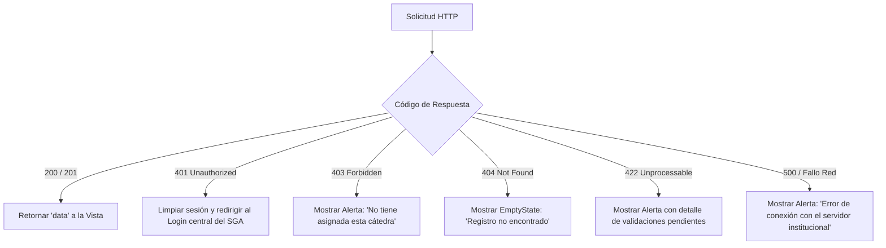

# 05 — Contrato de Integración Frontend-Backend

> **Versión del contrato:** 0.1.0 (Propuesta inicial)  
> **Fecha de redacción:** 2026-10-16  
> **Estado:** Propuesta técnica — pendiente de revisión grupal  
> **Fuente de evidencia:** Arquitectura de `src/services/academicService.ts` y componentes de vista

---

## 1. Propósito y Estrategia de Migración

El frontend del Módulo Profesor fue diseñado con una **capa de servicios completamente desacoplada** (`src/services/academicService.ts`). 

El objetivo de este contrato es establecer la guía técnica exacta para reemplazar el almacenamiento local simulado (`localStorage`) por peticiones HTTP asíncronas hacia el backend, **sin requerir cambios estructurales en las vistas (`views/`) ni en los componentes de interfaz (`components/`)**.

---

## 2. Variables de Entorno del Frontend

Para la conexión con el backend en entornos de desarrollo y producción, el frontend utilizará variables estándar de Vite (`.env`):

```bash
# URL base del backend SGA ISFDyT N.° 26
VITE_API_BASE_URL=http://localhost:3000/api/v1

# Timeout para solicitudes HTTP (en milisegundos)
VITE_API_TIMEOUT=10000

# Bandera para habilitar o deshabilitar funcionalidades exclusivas de demo
VITE_ENABLE_DEMO_TOOLS=false
```

---

## 3. Matriz de Mapeo: Métodos del Servicio vs. Peticiones HTTP

| Método en `academicService.ts` | Endpoint Backend | Método HTTP | Payload enviado | Transformación esperada |
|---|---|---|---|---|
| `getCurrentTeacher()` | `/teachers/me` | `GET` | Ninguno | Retorna objeto `Teacher` |
| `getCommissions(teacherId?)` | `/commissions` | `GET` | Query params opcionales | Retorna arreglo `Commission[]` |
| `getCommissionById(commissionId)` | `/commissions/{id}` | `GET` | Ninguno | Retorna `Commission` |
| `getStudentsByCommission(id, filters)` | `/commissions/{id}/students` | `GET` | Query params (`searchQuery`, `status`, `sortBy`, `sortOrder`) | Retorna `Student[]` |
| `getClassSessions(commissionId)` | `/commissions/{id}/sessions` | `GET` | Ninguno | Retorna `ClassSession[]` |
| `getClassSessionById(sessionId)` | `/sessions/{id}` | `GET` | Ninguno | Retorna `ClassSession` |
| `createOrOpenClassSession(commissionId, date, topic)` | `/commissions/{commissionId}/sessions` | `POST` | `{ date, topic }` | Retorna `ClassSession` |
| `getAttendanceBySession(sessionId)` | `/sessions/{sessionId}/attendance` | `GET` | Ninguno | Retorna `AttendanceRecord[]` |
| `saveAttendance(sessionId, records, teacherId)` | `/sessions/{sessionId}/attendance` | `PUT` | `{ records: [{ studentId, status }] }` | Retorna `{ success, message, count }` |
| `getObservations(filters)` | `/observations` | `GET` | Query params (`commissionId`, `studentId`, `searchQuery`) | Retorna `AcademicObservation[]` |
| `createObservation(data)` | `/observations` | `POST` | Objeto `Omit<AcademicObservation, 'id' \| 'createdAt'>` | Retorna `AcademicObservation` creada |
| `resetDemoData()` | — | — | Solo en desarrollo | En producción no emite petición o apunta a endpoint de sandbox |

---

## 4. Adaptador de Cliente HTTP Recomendado

Se propone encapsular las llamadas mediante una instancia centralizada (ej. `fetch` nativo o `axios`):

```typescript
// src/services/apiClient.ts (Propuesta de implementación)
const API_BASE = import.meta.env.VITE_API_BASE_URL || '/api/v1';

export async function apiRequest<T>(
  endpoint: string,
  options: RequestInit = {}
): Promise<T> {
  const token = localStorage.getItem('sga_auth_token'); // o cookie httpOnly

  const headers: HeadersInit = {
    'Content-Type': 'application/json',
    ...(token ? { Authorization: `Bearer ${token}` } : {}),
    ...options.headers,
  };

  const response = await fetch(`${API_BASE}${endpoint}`, {
    ...options,
    headers,
  });

  if (!response.ok) {
    const errorData = await response.json().catch(() => ({}));
    throw new ApiError(response.status, errorData.message || 'Error en la petición');
  }

  const json = await response.json();
  return json.data as T;
}
```

---

## 5. Manejo Centralizado de Errores

El frontend cuenta con componentes dedicados para retroalimentación (`AlertNotification.tsx` y `EmptyState.tsx`). El cliente de API debe normalizar los errores según los códigos HTTP:



---

## 6. Preservación del Estado en la Interfaz de Usuario

Para asegurar la accesibilidad y la fluidez de interacción:
1. **Estados de Carga (`isLoading`):** Todas las vistas ya disponen de banderas `isLoading` que deshabilitan botones de acción durante el tránsito de la solicitud para evitar dobles envíos.
2. **Confirmaciones Previas:** Los modales de confirmación (`ConfirmModal`) deben activarse antes de invocar los métodos del servicio, asegurando que solo se disparen peticiones HTTP cuando el usuario confirma expresamente la acción.
3. **Optimismo vs. Confirmación Real:** Para asistencia y observaciones, **no se recomienda actualización optimista** sin confirmación del servidor, dado que la asistencia y los informes cualitativos son documentos pedagógicos con impacto administrativo.
