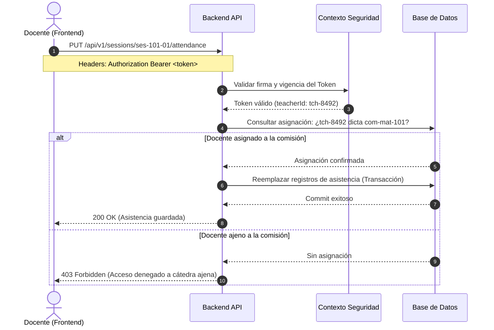

# 06 — Seguridad, Privacidad y Estrategia de Pruebas

> **Versión del contrato:** 0.1.0 (Propuesta inicial)  
> **Fecha de redacción:** 2026-10-16  
> **Estado:** Propuesta técnica — pendiente de revisión grupal  
> **Fuente de evidencia:** Principios de seguridad institucional, Ley 25.326 y casos de uso del módulo

---

## 1. Seguridad y Control de Acceso

### 1.1. Autenticación y Ciclo de Vida del Token
- **Mecanismo sugerido:** Tokens JWT (JSON Web Tokens) firmados con algoritmo asimétrico (RS256) o simétrico robusto (HS256 con clave de 256 bits mínimo).
- **Transporte recomendado:** Cabecera `Authorization: Bearer <token>` o cookies con directivas `HttpOnly`, `Secure` y `SameSite=Lax`.
- **Expiración y Renovación:**
  - Token de acceso (*Access Token*): Vida útil corta (15 a 60 minutos).
  - Token de refresco (*Refresh Token*): Almacenado de forma segura para permitir extensión de sesión activa.
- **Revocación:** Capacidad de invalidar sesiones ante cambios de credenciales o baja docente.

### 1.2. Autorización Basada en Atributos (ABAC)
El backend no debe conformarse con validar el rol `ROLE_TEACHER`; debe validar la **propiedad de la cátedra**:
1. Extraer `teacherId` del contexto de seguridad.
2. Comprobar que existe un registro activo en la tabla de asignaciones para la `commissionId` solicitada.
3. Si la verificación falla, responder inmediatamente con código HTTP `403 Forbidden` sin filtrar datos parciales.



### 1.3. Sanitización y Prevención de Inyecciones
- **Prevención de XSS (Cross-Site Scripting):** El campo `content` de las observaciones pedagógicas permite texto libre. El backend debe:
  - Sanitizar o escapar caracteres HTML (`<script>`, `<iframe>`, tags maliciosos) antes de persistir o emitir el contenido.
  - El frontend en React escapa por defecto las cadenas en el DOM, pero la defensa en profundidad en el backend es obligatoria.
- **Prevención de Inyección SQL:** Uso estricto de consultas preparadas (*prepared statements*) o mapeadores objeto-relacional (ORM) seguros. Jamás concatenar parámetros en cadenas SQL crudas.
- **Límites de Carga Útil:** Fijar tamaño máximo para el cuerpo de solicitudes HTTP (ej. máximo 500 KB para evitar ataques de denegación de servicio por agotamiento de memoria).

### 1.4. Protección de Datos Personales (Ley N.° 25.326)
Los datos de los estudiantes (DNI, nombres, legajos, correos electrónicos y notas pedagógicas cualitativas) constituyen información personal y académica amparada por la legislación argentina:
- No exponer contraseñas, hashes ni campos sensibles innecesarios en las respuestas de estudiantes.
- Los logs de depuración del servidor **no deben imprimir datos personales identificables (PII) ni DNI**.
- Todo tráfico en tránsito debe operar forzosamente sobre HTTPS (TLS 1.3 recomendado).

---

## 2. Estrategia de Pruebas Técnicas del Backend

Para validar el cumplimiento del contrato antes de integrar el frontend, el backend debe superar la siguiente matriz de pruebas:

### 2.1. Casos de Prueba de Integración (Suite Automatizada)

| ID | Caso de Prueba | Entrada / Precondición | Código HTTP Esperado | Criterio de Aceptación |
|---|---|---|---|---|
| **TC-SEC-01** | Petición sin token de autenticación | `GET /api/v1/commissions` sin header `Authorization` | `401 Unauthorized` | Cuerpo de error estándar con código `UNAUTHORIZED`. |
| **TC-SEC-02** | Acceso a comisión de otro docente | Docente `tch-8492` solicita nómina de comisión asignada a otro docente | `403 Forbidden` | No revela estudiantes ni detalles de la comisión ajena. |
| **TC-ASI-01** | Registro de asistencia con nómina completa | Arreglo de 18 registros para 18 estudiantes matriculados | `200 OK` | Marca sesión como `isClosed: true` y actualiza contador. |
| **TC-ASI-02** | Asistencia incompleta (falta calificar estudiantes) | Arreglo de 15 registros para comisión con 18 matriculados | `422 Unprocessable Entity` | Rechaza el guardado indicando la cantidad de faltantes. |
| **TC-ASI-03** | Asistencia con estado no contemplado | Registro con estado `"PRESENTE_CON_AVISO"` | `400 Bad Request` | Falla validación de esquema; solo permite PRESENTE, AUSENTE, TARDE. |
| **TC-OBS-01** | Registro de observación válida | Contenido con más de 15 caracteres y categoría oficial | `201 Created` | Devuelve observación con `id` y `createdAt` del servidor. |
| **TC-OBS-02** | Observación con contenido demasiado breve | Contenido: `"Estudiante faltó"` (15 caracteres exactos sin espacios útiles) | `400 Bad Request` | Rechaza por incumplimiento de longitud descriptiva mínima. |
| **TC-OBS-03** | Observación con fecha futura | `pedagogicalDate: "2099-01-01"` | `400 Bad Request` | Rechaza por inconsistencia cronológica. |

---

## 3. Ejemplo de Colección cURL para Verificación Rápida

### 3.1. Consulta de Comisiones
```bash
curl -X GET "https://sga.isfdyt26.edu.ar/api/v1/commissions" \
  -H "Authorization: Bearer <TOKEN_JWT_DOCENTE>" \
  -H "Accept: application/json"
```

### 3.2. Confirmación de Asistencia de Sesión
```bash
curl -X PUT "https://sga.isfdyt26.edu.ar/api/v1/sessions/ses-101-01/attendance" \
  -H "Authorization: Bearer <TOKEN_JWT_DOCENTE>" \
  -H "Content-Type: application/json" \
  -d '{
    "records": [
      { "studentId": "est-101", "status": "PRESENTE" },
      { "studentId": "est-102", "status": "PRESENTE" },
      { "studentId": "est-103", "status": "TARDE" },
      { "studentId": "est-104", "status": "AUSENTE" }
    ]
  }'
```

### 3.3. Creación de Observación Cualitativa
```bash
curl -X POST "https://sga.isfdyt26.edu.ar/api/v1/observations" \
  -H "Authorization: Bearer <TOKEN_JWT_DOCENTE>" \
  -H "Content-Type: application/json" \
  -d '{
    "commissionId": "com-mat-101",
    "commissionName": "1° A - Turno Tarde (Práctica Docente I)",
    "studentId": "est-101",
    "studentName": "Álvarez, Camila Belén",
    "studentLegajo": "EST-2026-0014",
    "pedagogicalDate": "2026-04-06",
    "category": "Seguimiento pedagógico",
    "content": "Participación muy activa en el debate sobre la primera visita a la escuela asociada."
  }'
```
