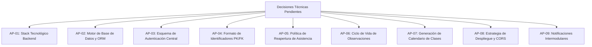

# 07 — Acuerdos Pendientes de Definición Grupal

> **Versión del contrato:** 0.1.0 (Propuesta inicial)  
> **Fecha de redacción:** 2026-10-16  
> **Estado:** Abierto para debate técnico y consenso con los demás módulos  
> **Participantes:** Desarrolladores de Módulo Docente, Preceptoría, Secretaría y Arquitectura Base

---

## 1. Propósito

Este documento cataloga las decisiones técnicas, funcionales y de arquitectura que **trascienden al Módulo Profesor** y requieren definición consensuada con los compañeros de equipo para asegurar una integración limpia y coherente del SGA del ISFDyT N.° 26.

---

## 2. Matriz de Decisiones Pendientes

---

## 3. Detalle de Acuerdos a Resolver

### AP-01: Stack Tecnológico y Lenguaje del Backend
- **Contexto:** El frontend está construido con React 19, TypeScript y Vite. La elección del backend debe considerar la curva de aprendizaje de todos los integrantes del grupo.
- **Opciones en evaluación:**
  - **Opción A (Node.js con TypeScript - Express o NestJS):** Permite compartir los tipos TypeScript ya tipados en `src/types/index.ts` directamente entre frontend y backend.
  - **Opción B (Python - FastAPI):** Muy ágil, genera documentación OpenAPI (Swagger) automática interactiva para probar endpoints.
  - **Opción C (Java / Spring Boot o C# / .NET):** Fuertemente tipado y de amplio uso institucional, pero con mayor sobrecarga de configuración inicial.
- **Recomendación del Módulo Profesor:** Opción A (Node.js/TypeScript) para reutilizar interfaces y unificar el lenguaje de desarrollo en todo el equipo.

---

### AP-02: Motor de Base de Datos y Mecanismo de Migración
- **Contexto:** Se requiere consistencia transaccional y relaciones estrictas (carreras, materias, comisiones, matrículas, asistencias, observaciones).
- **Opciones en evaluación:**
  - **PostgreSQL:** Excelente soporte para tipos enumerados institucionales (`shift`, `attendance_status`), transacciones ACID robustas y amplia compatibilidad.
  - **MySQL / MariaDB:** Ampliamente difundido y sencillo de desplegar en entornos académicos compartidos.
- **Recomendación:** PostgreSQL con un ORM/Query Builder estandarizado (Prisma, Drizzle o TypeORM si se utiliza Node.js; SQLAlchemy si es Python).

---

### AP-03: Esquema Centralizado de Autenticación y Sesión
- **Contexto:** El docente debe acceder al sistema a través de un login institucional unificado que luego le otorgue el contexto para su módulo.
- **Preguntas a acordar:**
  1. ¿Quién emite los tokens JWT? ¿Habrá un servicio/módulo de autenticación independiente o estará dentro de una misma API monolítica?
  2. ¿Qué claims mínimos llevará el payload del token? (Sugerido: `sub` / `userId`, `role`, `email`, `name`).
  3. ¿Cómo se almacenará el token en el cliente? (Sugerido: Cookie `HttpOnly` para mayor protección contra XSS, o `localStorage` si se opta por portabilidad de prototipo).

---

### AP-04: Formato Estándar de Identificadores (PKs y FKs)
- **Contexto:** En el mock actual del frontend se emplearon prefijos legibles (`tch-8492`, `com-mat-101`, `est-101`, `ses-101-01`).
- **Opciones en evaluación:**
  - **UUID v4 (ej. `a0eebc99-9c0b-4ef8-bb6d-6bb9bd380a11`):** Ideal para sistemas distribuidos y evita colisiones si distintos módulos insertan registros.
  - **Autoincremental entero (`1, 2, 3...`):** Más simple y compacto, pero predecible si no se protege la API.
- **Acuerdo requerido:** Adoptar una convención homogénea para que ningún módulo asuma enteros cuando otro provea cadenas de texto.

---

### AP-05: Política de Reapertura y Corrección de Asistencia
- **Contexto:** El frontend permite volver a seleccionar una clase previa y reguardar la asistencia. En un entorno institucional real, la planilla de asistencia tiene carácter de documento oficial.
- **Preguntas a acordar:**
  1. ¿Hasta cuándo tiene permitido el docente rectificar una asistencia cerrada? (Ejemplo: ¿Dentro de las 48 horas de dictada la clase?).
  2. Pasado ese lapso, ¿la modificación requiere habilitación explícita por parte de Preceptoría o Secretaría?
  3. ¿Debe mantenerse un log histórico de auditoría por cada rectificación con el motivo del cambio?

---

### AP-06: Ciclo de Vida y Permisos sobre Observaciones Pedagógicas
- **Contexto:** Actualmente, el frontend permite registrar observaciones y consultarlas en un historial inmutable.
- **Preguntas a acordar:**
  1. ¿Se debe permitir al docente autor corregir erratas ortográficas o de redacción dentro de un período ventana breve (ej. 24 hs)?
  2. ¿Se debe permitir el borrado de observaciones, o rige el principio de inmutabilidad tipo *audit log* (solo anulación con motivo visible)?
  3. ¿Quiénes además del docente de la cátedra pueden leer estas observaciones? (¿Preceptoría? ¿Gabinete de Orientación? ¿Directivos?).

---

### AP-07: Responsabilidad sobre la Generación de Instancias de Clase
- **Contexto:** En el frontend, el docente puede ingresar una fecha arbitraria y crear una instancia de clase (`createOrOpenClassSession`).
- **Preguntas a acordar:**
  - **Enfoque A (Bajo demanda):** El docente crea la clase en el momento de tomar asistencia.
  - **Enfoque B (Preprogramado):** Secretaría o Preceptoría cargan al inicio del cuatrimestre el cronograma oficial de fechas de cursada según el calendario académico institucional, y el docente solo selecciona la clase correspondiente.

---

### AP-08: Configuración de CORS y Estrategia de Despliegue
- **Contexto:** Durante el desarrollo local grupal, el frontend corre en Vite (`http://localhost:5173`) y el backend correrá en otro puerto (ej. `3000` u `8000`).
- **Acuerdo requerido:**
  - Configuración explícita de cabeceras CORS en el backend para admitir solicitudes con credenciales desde el origen del frontend local.
  - Alternativamente, configurar el proxy de desarrollo de Vite en `vite.config.ts` para redirigir `/api` al backend sin bloqueos de navegador.

---

### AP-09: Integración de Alertas y Notificaciones Intermodulares
- **Contexto:** Cuando un profesor registra una observación bajo la categoría `"Adecuación / Apoyo"` o un estudiante acumula reiteradas ausencias consecutivas:
- **Preguntas a acordar:**
  1. ¿Debe el backend disparar un evento o flag para que Preceptoría visualice una alerta preventiva de riesgo de deserción o pérdida de regularidad?
  2. ¿Se implementará mediante una cola de mensajería interna, polling sobre tablas comunes o triggers en base de datos?

---

## 4. Próximos Pasos Recomendados para la Reunión Grupal

1. **Presentar este conjunto de documentos (`docs/contrato-backend/`)** a los integrantes del equipo que desarrollarán el backend y los módulos complementarios.
2. **Definir AP-01, AP-02 y AP-03** con carácter prioritario para iniciar el esqueleto del servidor.
3. Validar los endpoints propuestos en `03-especificacion-api-rest.md` en una sesión de revisión conjunta antes de redactar código del servidor.
