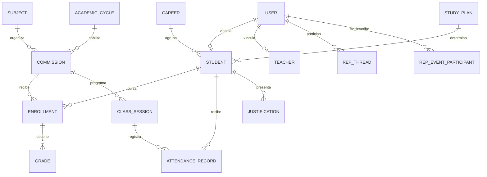

# Ecosistema 2.0 — arquitectura y plan por etapas

**Objetivo:** conectar los módulos Alumno, Preceptoría, Centro de Estudiantes y Auxiliares con una base PostgreSQL única en Neon y un backend común, conservando datos y permisos propios de cada dominio.

## Decisión de arquitectura

- **Una base institucional:** Neon/PostgreSQL.
- **Un repositorio y backend modular:** Hono + Prisma bajo `/api/v1`.
- **Cuatro módulos funcionales:** cada app consume los endpoints autorizados de su rol; no se conecta directamente a Neon.
- **Identidad común:** `User` y sesiones institucionales; Alumno tiene una ficha `Student` vinculada opcionalmente, Centro identifica participantes por `User`, y Auxiliares opera con rol `STAFF`.
- **Datos en común con propiedad clara:** Preceptoría y Profesores comparten planillas de asistencia; Alumno consulta sus propios datos; Centro administra su comunidad; Auxiliares administra el edificio. Compartir infraestructura no mezcla permisos ni pantallas.
- **Decisión del usuario (2026-10-30):** todos los preceptores gestionan las fichas de todos los alumnos del instituto y pueden leer sus datos sensibles. El backend ejecuta los permisos; ningún panel accede directamente a Neon.

## Inventario que ya existe

### Base y backend

El esquema Prisma ya contiene identidad y sesiones, carreras, planes, materias, ciclos, comisiones, alumnos, inscripciones, asistencia, justificaciones y calificaciones. También contiene las tablas de Centro (`RepEvent`, participantes, hilos, respuestas, anuncios y reclamos) y Auxiliares (`StaffTask`, `Installation`, `Incident`, `MaintenanceLog`). No corresponde empezar otra base ni recrear las tablas existentes.

`Commission.preceptorUserId` guarda el usuario preceptor asignado, y la API usa esa asignación para limitar las comisiones visibles. Hoy es un UUID escalar, no una relación Prisma con `User`; esto debe revisarse como tarea de integridad referencial antes de ampliar asignaciones.

### Estado funcional observado

| Módulo | Ya conectado | Trabajo pendiente principal |
|---|---|---|
| Alumno | La V2 local tiene login institucional y adaptadores API para sus lecturas académicas, agenda, avisos, foros y notificaciones | Publicar y validar la V2; acordar y habilitar trámites de justificación, correcciones y QR; reemplazar datos locales de preferencias si deben compartirse |
| Preceptoría | Permisos locales para padrón global, fichas, inscripciones y lectura sensible; pantalla inicial de padrón; asistencia/justificaciones por API en comisiones asignadas | Compilar y validar la pantalla con QA; avisos, agenda y foro siguen parcialmente en memoria; reemplazar sus datos de ejemplo |
| Centro de Estudiantes | Eventos, participación, foro, anuncios y reclamos tienen endpoints | Revisar todas las pantallas en modo API y completar validación por rol |
| Auxiliares | Tareas, instalaciones, incidencias y mantenimiento tienen endpoints protegidos por rol | Terminar turnos y validar visualmente las operaciones; conservar datos aislados del alumno |

La API ya tiene rutas de personas y estructura (`/structure/students`, `/structure/enrollments`), asistencia (`/attendance/*`), datos propios (`/me/*`), Centro (`/centro/*`) y Auxiliares (`/staff/*`). En esta etapa se abrió localmente a PRECEPTOR el padrón global, alta/edición de fichas, gestión de inscripciones y lectura de datos sensibles. Vincular una cuenta al legajo y modificar datos sensibles siguen reservados a Dirección/Administración/Superadmin. La asistencia y revisión de justificaciones permanecen restringidas a comisiones asignadas.

## Relación principal de datos

El preceptor tiene acceso institucional al padrón y a la lectura de datos sensibles por decisión explícita del usuario. El modelo separa `StudentSensitiveData` de la ficha ordinaria; su actualización y la vinculación de cuenta siguen siendo operaciones administrativas. Las operaciones de asistencia y justificaciones conservan alcance por comisión asignada. Los datos de Auxiliares no se relacionan con la ficha del alumno salvo auditoría o configuración institucional expresamente definida.

## Etapas de implementación

### Etapa 1 — Reglas de gobierno y permisos (decisión cerrada)

Todos los preceptores tienen alcance institucional sobre fichas, inscripciones y lectura de datos sensibles. Dirección/Administración conserva la vinculación de cuentas y la escritura de datos sensibles. La operación de asistencia/justificaciones continúa limitada por comisiones asignadas; ajustar ese alcance será una decisión separada.

### Etapa 2 — Diferencias de esquema y consistencia

Comparar Prisma, migraciones y datos actuales de Neon; identificar únicamente diferencias necesarias. Revisar la referencia de `preceptorUserId`, índices y reglas de baja. Preparar migración reversible y pruebas en PostgreSQL local aislado. **No crear ni aplicar migraciones en Neon antes de aprobar el diff y el respaldo.**

### Etapa 3 — Endpoints de Preceptoría para alumnos (permisos base implementados)

`/structure/students` permite a PRECEPTOR consultar todos los alumnos y crear/actualizar ficha; `/structure/careers` entrega el catálogo para el formulario; `/structure/enrollments` permite consultar/crear/cambiar condiciones a escala institucional. `/structure/students/:id/sensitive` permite lectura global a PRECEPTOR. Las operaciones administrativas de vinculación de cuenta, escritura de datos sensibles y borrado físico de inscripción permanecen restringidas. No hay permiso SQL ni acceso directo a tablas.

### Etapa 4 — Conectar las cuatro apps (Preceptoría: padrón inicial implementado)

La app consolidada ya incorpora una pantalla de padrón para PRECEPTOR con búsqueda, alta/edición de ficha y consulta puntual de datos sensibles. Falta compilarla en el entorno del módulo y completar su revisión visual. En las cuatro apps, consumir el mismo cliente de sesión/API; reemplazar stores demo restantes; eliminar IDs o carreras fijas; mantener dominios Centro/Auxiliares separados; hacer que Alumno refleje las escrituras compartidas.

### Etapa 5 — QA de extremo a extremo

En base local aislada, probar altas y cambios con cuentas QA para cada rol: Preceptor carga asistencia → Alumno la consulta; Preceptor registra/revisa justificación → Alumno ve estado; Centro publica evento → Alumno se anota; Auxiliar actualiza una incidencia → solo personal autorizado la consulta. Probar además denegación cruzada, sesión vencida, duplicados, auditoría y datos sensibles.

### Etapa 6 — Publicación gradual

Aplicar cualquier migración aprobada primero en el entorno de publicación previsto; desplegar el backend y luego las apps compatibles; comprobar endpoints y flujos desde navegador. Registrar commit, migración, build, pruebas y URLs por separado. Un push a este repositorio no actualiza por sí solo el deploy productivo del repositorio `mjsis20052/sistema-gestion-i26`.

## Límites de seguridad

- Las apps nunca conocen `DATABASE_URL`; solo el backend usa credenciales Neon.
- El servidor deriva la identidad de la cookie HttpOnly y autoriza cada endpoint.
- Preceptoría no obtiene acceso irrestricto a toda Neon por ser responsable del dominio.
- El alumno solo recibe su información; Auxiliares no recibe el legajo académico.
- Los datos personales sensibles se consultan y modifican por permisos específicos, con auditoría de cambios y minimización. Falta incorporar auditoría de lectura sensible antes de publicar el nuevo alcance global.
- Ninguna operación se anuncia como guardada si el backend no confirma éxito.

## Próximo paso concreto

Validar la pantalla de Padrón con QA; completar después la gestión visual de inscripciones y sustituir stores de avisos/agenda/foro. Antes de publicar el acceso global a datos sensibles, agregar auditoría de lecturas. No se requiere crear tablas para los permisos actuales; revisar la relación de preceptor asignado a comisión como mejora de integridad antes de cambiar el esquema.
