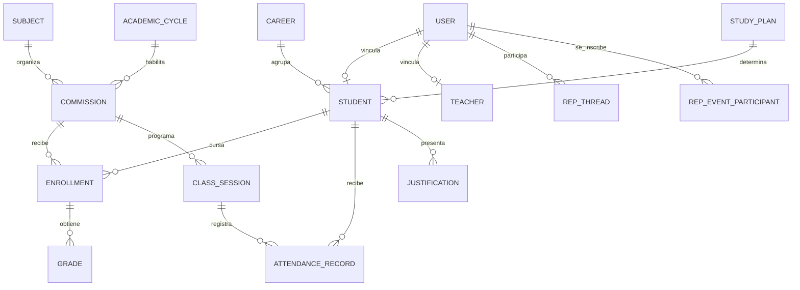

# Ecosistema 2.0 — arquitectura y plan por etapas

**Objetivo:** conectar los módulos Alumno, Preceptoría, Centro de Estudiantes y Auxiliares con una base PostgreSQL única en Neon y un backend común, conservando datos y permisos propios de cada dominio.

## Decisión de arquitectura

- **Una base institucional:** Neon/PostgreSQL.
- **Un repositorio y backend modular:** Hono + Prisma bajo `/api/v1`.
- **Cuatro módulos funcionales:** cada app consume los endpoints autorizados de su rol; no se conecta directamente a Neon.
- **Identidad común:** `User` y sesiones institucionales; Alumno tiene una ficha `Student` vinculada opcionalmente, Centro identifica participantes por `User`, y Auxiliares opera con rol `STAFF`.
- **Datos en común con propiedad clara:** Preceptoría y Profesores comparten planillas de asistencia; Alumno consulta sus propios datos; Centro administra su comunidad; Auxiliares administra el edificio. Compartir infraestructura no mezcla permisos ni pantallas.
- **Preceptoría gobierna la información académica de alumnos dentro del alcance institucional acordado.** El código actual limita al preceptor a comisiones asignadas; no hay acceso directo de ningún panel a la base.

## Inventario que ya existe

### Base y backend

El esquema Prisma ya contiene identidad y sesiones, carreras, planes, materias, ciclos, comisiones, alumnos, inscripciones, asistencia, justificaciones y calificaciones. También contiene las tablas de Centro (`RepEvent`, participantes, hilos, respuestas, anuncios y reclamos) y Auxiliares (`StaffTask`, `Installation`, `Incident`, `MaintenanceLog`). No corresponde empezar otra base ni recrear las tablas existentes.

`Commission.preceptorUserId` guarda el usuario preceptor asignado, y la API usa esa asignación para limitar las comisiones visibles. Hoy es un UUID escalar, no una relación Prisma con `User`; esto debe revisarse como tarea de integridad referencial antes de ampliar asignaciones.

### Estado funcional observado

| Módulo | Ya conectado | Trabajo pendiente principal |
|---|---|---|
| Alumno | La V2 local tiene login institucional y adaptadores API para sus lecturas académicas, agenda, avisos, foros y notificaciones | Publicar y validar la V2; acordar y habilitar trámites de justificación, correcciones y QR; reemplazar datos locales de preferencias si deben compartirse |
| Preceptoría | Lee alumnos dentro del alcance y registra asistencia/justificaciones por API compartida | Alta/edición de ficha académica bajo permisos; avisos, agenda y foro siguen parcialmente en memoria; usar catálogos reales en vez de carreras de ejemplo |
| Centro de Estudiantes | Eventos, participación, foro, anuncios y reclamos tienen endpoints | Revisar todas las pantallas en modo API y completar validación por rol |
| Auxiliares | Tareas, instalaciones, incidencias y mantenimiento tienen endpoints protegidos por rol | Terminar turnos y validar visualmente las operaciones; conservar datos aislados del alumno |

La API ya tiene rutas de personas y estructura (`/structure/students`, `/structure/enrollments`), asistencia (`/attendance/*`), datos propios (`/me/*`), Centro (`/centro/*`) y Auxiliares (`/staff/*`). Las rutas actuales de alta/edición de ficha de alumno están reservadas a Dirección, Administración y Superadmin; Preceptoría solo lee su roster y opera asistencia/justificaciones en las comisiones asignadas.

## Relación principal de datos

El vínculo de Preceptoría con el roster se obtiene mediante las comisiones asignadas y sus inscripciones. Los datos sensibles (`StudentSensitiveData`) están separados de la ficha académica y requieren permiso específico. Los datos de Auxiliares no se relacionan con la ficha del alumno salvo auditoría o configuración institucional expresamente definida.

## Etapas de implementación

### Etapa 1 — Reglas de gobierno y permisos

Definir si cada preceptor ve y edita **solo los alumnos de sus comisiones asignadas** o si necesita un alcance institucional más amplio. Recomendación inicial: roster asignado; Dirección/Administración conserva altas de identidad y estructura; Preceptoría gestiona los datos académicos y administrativos autorizados de ese roster. Separar siempre datos sensibles.

### Etapa 2 — Diferencias de esquema y consistencia

Comparar Prisma, migraciones y datos actuales de Neon; identificar únicamente diferencias necesarias. Revisar la referencia de `preceptorUserId`, índices y reglas de baja. Preparar migración reversible y pruebas en PostgreSQL local aislado. **No crear ni aplicar migraciones en Neon antes de aprobar el diff y el respaldo.**

### Etapa 3 — Endpoints de Preceptoría para alumnos

Diseñar y luego implementar endpoints limitados por rol/alcance para consultar el roster, actualizar los campos que se le deleguen, inscribir alumnos o modificar condiciones si corresponde, y auditar cada cambio. No dar permiso de SQL ni acceso general a tablas. Mantener alta de usuario, vínculo de identidad y campos sensibles bajo una política explícita.

### Etapa 4 — Conectar las cuatro apps

Consumir el mismo cliente de sesión/API en los frontends. Reemplazar stores demo en cada flujo; eliminar IDs o carreras fijas; definir estados de carga, error, reintento y éxito real; mantener separados los dominios del Centro y Auxiliares. Hacer que Alumno refleje asistencia/justificaciones y que Preceptoría vea el mismo registro al volver a consultar.

### Etapa 5 — QA de extremo a extremo

En base local aislada, probar altas y cambios con cuentas QA para cada rol: Preceptor carga asistencia → Alumno la consulta; Preceptor registra/revisa justificación → Alumno ve estado; Centro publica evento → Alumno se anota; Auxiliar actualiza una incidencia → solo personal autorizado la consulta. Probar además denegación cruzada, sesión vencida, duplicados, auditoría y datos sensibles.

### Etapa 6 — Publicación gradual

Aplicar cualquier migración aprobada primero en el entorno de publicación previsto; desplegar el backend y luego las apps compatibles; comprobar endpoints y flujos desde navegador. Registrar commit, migración, build, pruebas y URLs por separado. Un push a este repositorio no actualiza por sí solo el deploy productivo del repositorio `mjsis20052/sistema-gestion-i26`.

## Límites de seguridad

- Las apps nunca conocen `DATABASE_URL`; solo el backend usa credenciales Neon.
- El servidor deriva la identidad de la cookie HttpOnly y autoriza cada endpoint.
- Preceptoría no obtiene acceso irrestricto a toda Neon por ser responsable del dominio.
- El alumno solo recibe su información; Auxiliares no recibe el legajo académico.
- Los datos personales sensibles se consultan y modifican por permisos específicos, con auditoría y minimización.
- Ninguna operación se anuncia como guardada si el backend no confirma éxito.

## Próximo paso concreto

Cerrar la matriz de alcance de Preceptoría y campos editables (Etapa 1). Con esa definición, preparar el contrato de endpoints faltantes y el diff de esquema; recién después iniciar la migración local.
