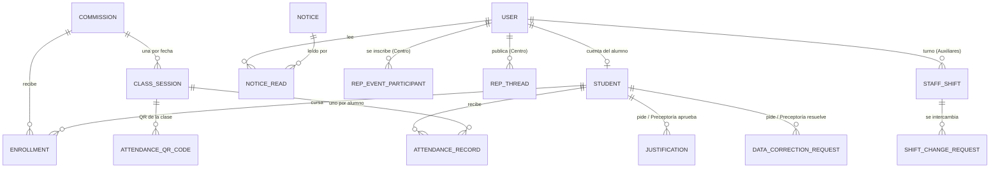

# Backend de los paneles de Julián y Lucía — Alumnos, Preceptoría, Centro y Auxiliares

> **Fecha:** 01/11/2026
> **Base:** el mismo esquema central (`backend/prisma/schema.prisma`) y la misma API `/api/v1`. No se creó una base paralela.
> **Estado:** implementado, conectado a las pantallas y probado en PostgreSQL local y online (Vercel + Neon propia, sección 8). En el repo del equipo está como **propuesta** (`PROPUESTAS.md` y `propuesta/backend.patch`); el backend común de `main` no se modificó.

## 1. Cómo se relacionan los cuatro paneles

Los cuatro paneles comparten la identidad (`User` + sesión con cookie) y leen o escriben las mismas tablas según su rol. Cada uno es dueño de sus datos; lo que se cruza pasa siempre por la API.



| Panel | Rol | Escribe | Lee de otros |
|---|---|---|---|
| **Alumnos** | `STUDENT` | Sus pedidos de justificación y de corrección de ficha, su presente por QR, lectura de comunicados, participación en Centro y foro | Ficha, materias, asistencia, notas publicadas, comunicados, calendario, Centro |
| **Preceptoría** | `PRECEPTOR` | Asistencia, justificaciones (aprueba), padrón e inscripciones, resolución de pedidos de corrección, QR de la clase, comunicados a sus carreras/comisiones | Todo el padrón y los datos sensibles (con auditoría de lectura) |
| **Centro de Estudiantes** | `STUDENT_REP` | Eventos, foro del Centro, anuncios, reclamos | Participantes de sus eventos |
| **Auxiliares** | `STAFF` | Tareas, instalaciones, incidencias, mantenimiento, pedidos y respuestas de cambio de turno | Su cronograma de turnos y el de sus compañeros |

El cronograma de turnos lo cargan Directivos/Administración (`DIRECTOR`, `ADMINISTRATIVE`, `SUPER_ADMIN`).

## 2. Qué se agregó

Dos migraciones:

- `20261101182015_paneles_alumno_preceptoria_auxiliares`: solo agrega 5 tablas y 4 enums. No modifica ni borra nada existente.
- `20261101184446_turnos_sin_superposicion`: cambia el índice único `(userId, date)` de `staff_shifts` por un índice común. Con el único no se podía intercambiar un turno cuando las dos personas trabajaban los dos días, ni cambiar mañana por tarde el mismo día. Ahora la regla es que los horarios de una persona no se superpongan, y la controla la API.

| Tabla | Para qué | Panel que la usa |
|---|---|---|
| `notice_reads` | Qué comunicado leyó cada usuario (antes quedaba en el navegador). Clave `(noticeId, userId)`. | Alumnos (y cualquier rol) |
| `attendance_qr_codes` | Código QR de una clase, con vencimiento y anulación. Se guarda **solo el hash** del código. | Preceptoría/Profesores generan; Alumnos escanean |
| `data_correction_requests` | Pedido del alumno para corregir un dato de su ficha. Aprobarlo **no** cambia la ficha. | Alumnos piden; Preceptoría/Administración resuelven |
| `staff_shifts` | Turno de un auxiliar en un día. Una persona puede tener más de uno si los horarios no se superponen (sin horario = todo el día). | Directivos cargan; Auxiliares consultan |
| `shift_change_requests` | Intercambio de turno entre dos auxiliares. | Auxiliares |

Enums nuevos: `CorrectionField`, `CorrectionStatus`, `StaffShiftType` (`REGULAR`, `SWAP`, `OFF`, `HOLIDAY`), `ShiftChangeStatus` (`PENDING`, `ACCEPTED`, `REJECTED`, `CANCELLED`). Los tipos equivalentes y sus etiquetas en castellano están al final de `shared/types.ts`.

La justificación pedida por el alumno **no** necesitó tabla: usa `justifications`, que ya existía.

## 3. Endpoints nuevos

Todos bajo `/api/v1`, con sesión. Errores con los códigos del contrato (`VALIDATION_ERROR`, `FORBIDDEN`, `NOT_FOUND`, `CONFLICT`, …).

### Alumnos (`/me`, roles `STUDENT` y `STUDENT_REP`)

| Método y ruta | Qué hace | Reglas |
|---|---|---|
| `POST /me/justifications` | Pide una justificación `{ fromDate, toDate, reason, documentUrl? }` → queda `PENDING` | `toDate ≥ fromDate`; 409 si ya tiene una pendiente que se superpone. Avisa a los preceptores de sus comisiones. |
| `GET /me/corrections` | Sus pedidos de corrección | — |
| `POST /me/corrections` | Pide corregir `{ field, proposedValue, reason, documentUrl? }` | El valor actual lo toma el servidor de la ficha. 409 si ya hay uno pendiente para ese dato. |
| `POST /me/attendance/qr` | Registra su presente con `{ code }` | Código válido, sin vencer ni anular, y alumno inscripto en la comisión (si no, 404 sin dar detalles). Crea `PRESENT` con origen `QR`. Si ya tenía registro en esa clase devuelve `alreadyRegistered: true` sin modificarlo. 409 si el código venció o la planilla está cerrada. |

### Comunicados (`/records`, todos los roles)

| Método y ruta | Qué hace |
|---|---|
| `GET /records/notices` | Ahora incluye `readAt` del usuario de la sesión (vacío = no leído). |
| `POST /records/notices/:id/read` | Lo marca como leído. Repetirlo conserva la primera fecha. 404 si el usuario no es destinatario. |

### Preceptoría y Profesores (`/attendance`, `/structure`)

| Método y ruta | Roles | Qué hace |
|---|---|---|
| `POST /attendance/sessions/:id/qr` | `PRECEPTOR`, `TEACHER`, `DIRECTOR`, `SUPER_ADMIN` (en su alcance) | Genera el código `{ minutes: 1–30, por defecto 10 }`. Devuelve el código en claro **una sola vez** (`XXXXX-XXXXX`). Anula el código anterior de esa clase. |
| `DELETE /attendance/sessions/:id/qr` | Ídem | Anula el código activo. |
| `GET /structure/corrections?status&studentId` | `PRECEPTOR` y Administración | Lista los pedidos de corrección. |
| `PATCH /structure/corrections/:id` | Ídem | `{ status: APPROVED | REJECTED, reviewNotes? }`. Se resuelve una sola vez (409 después). Avisa al alumno. |

### Auxiliares (`/staff`)

| Método y ruta | Roles | Qué hace |
|---|---|---|
| `GET /staff/people` | Auxiliares y Directivos | Auxiliares activos (para elegir compañero/a). |
| `GET /staff/shifts?from&to&userId` | Ídem | Cronograma. |
| `POST /staff/shifts` · `PATCH|DELETE /staff/shifts/:id` | Solo Directivos/Administración | Alta, edición y baja de turnos. 409 si se superpone con otro turno de esa persona; 400 si la hora de fin no es posterior a la de inicio. |
| `GET /staff/shift-changes?status` | Auxiliar: los suyos · Directivos: todos | Pedidos de cambio. |
| `POST /staff/shift-changes` | `STAFF` | `{ requesterShiftId, colleagueShiftId, reason? }`: el primero tiene que ser propio y el segundo de otra persona (puede ser el mismo día). 409 si ya hay un pedido pendiente sobre esos turnos o si, con el cambio, a alguno de los dos se le superponen turnos. |
| `PATCH /staff/shift-changes/:id` | Compañero/a (aceptar/rechazar), quien pidió (cancelar) o Directivos | Al aceptar, se intercambian los titulares de los dos turnos y quedan como `SWAP`, en una sola transacción. |

Todas las escrituras quedan en `audit_logs`, y los cambios de estado generan una `Notification` para la persona afectada.

## 4. Qué se probó

| Qué | Dónde | Resultado |
|---|---|---|
| `prisma validate`, `prisma generate`, `npm run typecheck` | Local | OK |
| Migraciones `migrate deploy` | PostgreSQL local `127.0.0.1:5452/qa_i26` y `127.0.0.1:5440/i26_dev` | Aplicadas las dos |
| `backend/test/paneles-flow.mjs` (flujos nuevos, permisos y errores; incluye cambio mañana↔tarde y superposición) | API QA local `127.0.0.1:4052` | OK |
| `backend/test/integration-flow.mjs` (batería anterior) | Ídem | OK: 5 escenarios académicos, 5 CRUD Centro/Auxiliares, alta HTTP, padrón y datos sensibles |
| Neon | — | **No consultado ni modificado** |
| Pantallas, desde el navegador | API de desarrollo `localhost:4000` → `i26_dev` | OK: Preceptoría genera un QR y el alumno lo ingresa (queda presente); el alumno pide una rectificación y una justificación y Preceptoría las aprueba (el alumno ve "Aprobada"); un auxiliar pide un cambio de turno y el compañero lo acepta (turnos intercambiados). No se probó desde la pantalla el "leído" de comunicados (sí por HTTP). |

No se probó el vencimiento real del QR (el mínimo es 1 minuto); la lógica compara `expiresAt` con la hora del servidor.

## 5. Pendiente

1. **Prototipos nuevos de AI Studio** (Centro, Auxiliares, Preceptores y Alumnos): no se pudieron leer porque AI Studio pide iniciar sesión. Este backend se diseñó a partir del código local (`ecosistema-julian-lucia/alumnos/app v2` y las pantallas de `consolidacion/`). Cuando estén descargados, comparar sus datos con este documento y anotar lo que falte como propuesta.
2. **Directivos:** la carga de turnos está en la pantalla de Turnos, pero solo la ve un superadministrador (la app consolidada no admite DIRECTOR). Falta sumarla al panel de Directivos.
3. **Neon:** aplicar la migración solo después de revisar el diff, con respaldo previo y `DIRECT_DATABASE_URL` explícita. Después publicar el backend desde el repo de deploy (`mjsis20052/sistema-gestion-i26`).
4. **Adjuntos:** `documentUrl` es una URL. No hay almacenamiento de archivos; definirlo antes de pedir certificados.
5. **Geolocalización del QR:** el prototipo viejo guardaba ubicación y radio. No se implementó; el control es el vencimiento corto y la inscripción.
6. **Fuera de este alcance:** edición y borrado de respuestas propias en los foros, recordatorios de eventos guardados en el servidor, y planificaciones y material didáctico (INT-108).
7. **Escáner de cámara del QR:** el portal del alumno sigue con el escáner simulado; el código se ingresa a mano. Para leer el QR con la cámara hace falta una librería de lectura y mostrar el código como imagen QR en Preceptoría (hoy se muestra como texto grande).

## 6. Cómo verlo en local

Requisitos: el PostgreSQL de desarrollo prendido (`127.0.0.1:5440`, base `i26_dev`) y las dependencias instaladas en la raíz, en `consolidacion/app` y en `ecosistema-julian-lucia/alumnos/app v2`.

```powershell
& "C:\Program Files\PostgreSQLin\pg_ctl" -D backend/.local-dev/pgdata -l backend/.local-dev/postgres.log -o "-p 5440 -h 127.0.0.1" start
npm run dev:api                                  # API → http://localhost:4000/api/v1
npm --prefix consolidacion/app run dev           # Preceptoría / Auxiliares / Centro → http://localhost:5177
npm --prefix "ecosistema-julian-lucia/alumnos/app v2" run dev     # Portal del alumno → http://127.0.0.1:3000
```

Cada comando del servidor va en su propia terminal. Las cuentas son las de `shared/testUsers.ts` (`prueba.preceptor`, `prueba.alumno`, `prueba.auxiliar`…), con la clave de ese archivo. Para el compañero de los cambios de turno: `demo.auxiliar2@example.invalid`, con la misma clave (solo en una base local).

- **Abrí el portal del alumno en `127.0.0.1:3000` y la app consolidada en `localhost:5177`.** Las dos usan la misma cookie de sesión: si las abrís las dos en `localhost`, al entrar en una se cierra la sesión de la otra.
- Para recargar los turnos de ejemplo: `npm run db:demo-data -- --shifts`, con `DATABASE_URL` apuntando a `i26_dev`.

## 7. Paneles nuevos del ecosistema (Centro, Auxiliares y Preceptoría de AI Studio) — 01/11/2026

Los tres prototipos nuevos están en `ecosistema-julian-lucia/centro`, `ecosistema-julian-lucia/auxiliares` y `ecosistema-julian-lucia/preceptoria`, junto al de Alumnos (`ecosistema-julian-lucia/alumnos/app v2`). Ninguno usa ya datos inventados: cada uno tiene login real, una capa `api/` propia y lee y escribe en la base compartida. Lo que queda en el navegador es solo preferencia de pantalla (tema, tamaño de texto, intro vista).

### Migración `20261101200000_ecosistema_centro_auxiliares_preceptoria`

Solo agrega: 1 tabla nueva (`staff_absences`), 4 enums y columnas opcionales.

| Panel | Cambio en la base | Endpoints |
|---|---|---|
| Centro | `rep_events`: `endTime`, `capacity`, `coverUrl` · `rep_announcements`: `summary`, `coverUrl`, `draft`, `attachments` (enlaces) · `rep_threads`: `hidden`, `hiddenReason`, `reported`, `reportReason` · `rep_claims`: `code` (REC-AAAA-NNN), `title`, `anonymous`, estado `FORWARDED`, `forwardedTo`, `forwardNote`, `archiveReason`, `history` | Inscripción con cupo (409 si está lleno) y aviso a quien creó el evento; inscriptos con email y carrera; borradores y programados ocultos para alumnos; `POST /centro/threads/:id/report`; ocultar y descartar denuncias; reclamo anónimo (nadie ve el autor salvo él mismo y Superadmin), derivación, archivo y línea de tiempo; aviso al Centro de cada reclamo y denuncia nuevos |
| Auxiliares | `staff_absences` (ausencias del propio personal) · `staff_tasks`: `priority`, `installationId` · `installations`: `code`, `floor`, `lastCleanedBy` · `incidents`: `notes` | `GET/POST/DELETE /staff/absences` y `PATCH` para Dirección; tareas con sector y prioridad; incidencia que cambia el estado del sector al reportarla y lo restaura al resolverla; foto como URL o imagen embebida (hasta ~1,5 MB); nombres de quién completó, limpió, reportó y resolvió |
| Preceptoría | `justifications`: `subjectId`, `documentType`, `documentName` · `forum_threads`: `channel` | `GET /attendance/summary/bulk` (resumen de toda la comisión); `GET /attendance/audit` (correcciones: cada cambio de estado de un registro ya cargado queda en `audit_logs`); justificación limitada a una materia; `PATCH` de justificación ya resuelta → 409; `GET /records/notices?mine=1`; canales del foro académico |

### Qué se probó

| Qué | Resultado |
|---|---|
| `npm run typecheck` (backend), `tsc --noEmit` y `vite build --base=/ecosistema-julian-lucia/<panel>/` de los tres paneles | OK |
| `backend/test/ecosistema-flow.mjs` (nueva) contra `qa_i26` | OK: Centro, Auxiliares y Preceptoría, con permisos y errores |
| `paneles-flow.mjs` e `integration-flow.mjs` | OK, sin regresiones |
| En el navegador, contra `i26_dev` | Los 4 paneles inician sesión y cargan datos reales. Cruce probado: el alumno pide una justificación en su portal → aparece en Preceptoría → Preceptoría la aprueba → queda `APPROVED`. |
| Neon, publicación | **No** |

No se probaron desde la pantalla los demás cruces (reclamo alumno → Centro, cambio de turno en el panel nuevo de Auxiliares, QR desde Preceptoría nueva); sí están cubiertos por las pruebas HTTP.

### Detalles conocidos

- En el Centro, la cuenta regresiva de la intro se reinicia sola; se entra con "Ingresar ahora". Auxiliares muestra en consola un aviso de React (`setState` durante el render en `IntroScreen`).
- El gráfico de Inicio de Preceptoría muestra el código de la comisión en lugar del nombre de la materia.
- Los reclamos cargados antes de la migración no tienen código: se muestran con el comienzo del id.
- No hay subida de archivos: portadas, adjuntos y certificados son enlaces o solo el nombre del archivo.
- Faltas en la API, según cada panel: preferencias de notificación, cargo/oficina/legajo del personal, contacto de emergencia del auxiliar, rol del autor en el foro académico y un "solo mis tareas" en Auxiliares.

### Cómo levantar los cuatro paneles

Además de la API (sección 6):

```powershell
npm --prefix "ecosistema-julian-lucia/alumnos/app v2" run dev   # 3000
npm --prefix ecosistema-julian-lucia/centro run dev             # 3001
npm --prefix ecosistema-julian-lucia/auxiliares run dev         # 3002
npm --prefix ecosistema-julian-lucia/preceptoria run dev        # 3003
```

**Abrí cada panel con su propio nombre `.localhost`** para que las sesiones no se pisen (la cookie depende del nombre del host):

- Alumno: http://alumno.localhost:3000
- Centro: http://centro.localhost:3001
- Auxiliares: http://aux.localhost:3002
- Preceptoría: http://preceptoria.localhost:3003

Cuentas: `prueba.alumno`, `prueba.centro`, `prueba.auxiliar` y `prueba.preceptor` `@isfdyt26.edu.ar`, con la clave de `shared/testUsers.ts`.

## 8. Versión online (Vercel + Neon) — 01/11/2026

Publicada en la cuenta de Vercel de Julián (`julian-camara-s-projects`), **separada** del sitio del equipo (`sistema-gestion-i26.vercel.app`, que no se tocó).

| Qué | Proyecto Vercel | URL |
|---|---|---|
| API (`/api/v1`) | `i26-ecosistema-api` | https://i26-ecosistema-api.vercel.app |
| Alumnos | `alumnos-julian-v2` (actualizado) | https://alumnos-julian-v2.vercel.app |
| Centro de Estudiantes | `i26-centro-estudiantes` | https://i26-centro-estudiantes.vercel.app |
| Auxiliares | `i26-auxiliares` | https://i26-auxiliares.vercel.app |
| Preceptoría | `i26-preceptoria` | https://i26-preceptoria.vercel.app |

- **Base:** Neon nueva, creada desde Vercel → Storage y conectada al proyecto de la API (variables `DATABASE_URL` y `DATABASE_URL_UNPOOLED`, marcadas como sensibles). **No** es el Neon del equipo.
- **Tablas:** cada publicación de la API corre `prisma migrate deploy` (`scripts/deploy-api.mjs` arma la carpeta `.deploy/i26-ecosistema-api`, ignorada por git).
- **Datos:** la primera publicación se hizo con `ONLINE_SEED=1`, que carga los datos de ejemplo (`demo-data.ts`) y las cuentas de prueba (`backend/src/online-seed.ts`) con una **contraseña privada**. Está en `.deploy/CUENTAS-ONLINE.txt` (ignorado por git). La contraseña pública del repo **no** funciona online.
- **Sesión:** cada panel tiene su `vercel.json`, que reenvía `/api/v1/*` a la API. Así la cookie de sesión queda en el dominio de cada panel y no hace falta CORS.
- **Probado (HTTP, 01/11):** los 4 sitios cargan (incluidas rutas internas); login y `/auth/me` con el rol correcto en cada uno; cruce online alumno → Preceptoría → alumno de una justificación (`APPROVED`).
- **Para volver a publicar:** API: `node scripts/deploy-api.mjs`, y desde `.deploy/i26-ecosistema-api`, `vercel deploy --prod`. Paneles: desde la carpeta de cada uno, `vercel deploy --prod`.
