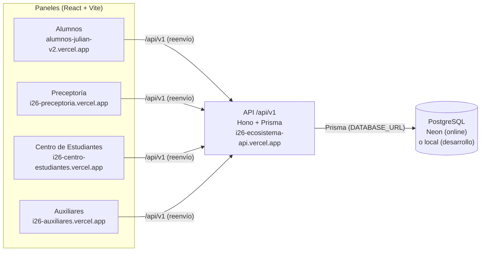
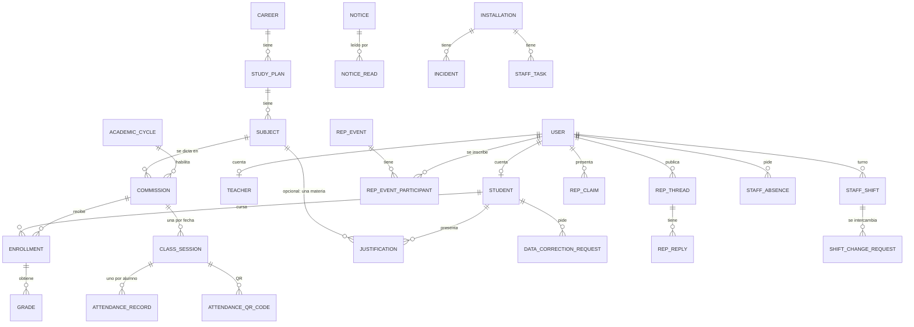

# Backend y base de datos del Ecosistema — ISFDyT N° 26

> **Responsable:** Julián · **Actualizado:** 01/11/2026
> Cómo está construida la base de datos que comparten los cuatro paneles (Alumnos, Preceptoría, Centro de Estudiantes y Auxiliares), a qué se conecta, qué endpoints expone y qué hace cada uno.

> ⚠️ **Estado en el repositorio del equipo:** las tablas y endpoints nuevos que necesitan estos paneles **todavía no están en el backend común** (`/backend` de `main`). Ese backend es de todo el equipo y no se modificó. Los cambios están **propuestos** en esta carpeta, como pide el Contrato de Unificación (sección 12):
> - [`PROPUESTAS.md`](PROPUESTAS.md): qué se agrega, tabla por tabla y endpoint por endpoint.
> - [`propuesta/backend.patch`](propuesta/backend.patch): el código listo para aplicar si el equipo lo aprueba (`git apply ecosistema-julian/backend/propuesta/backend.patch` desde la raíz).
>
> La versión **online** (Vercel + Neon) ya corre con esos cambios aplicados.

**Dónde está el código:** el backend común vive en [`/backend`](../../backend), en la raíz del repo. Los archivos que se nombran abajo y no existen todavía en `main` (migraciones nuevas, `online-seed.ts`, `paneles-flow.mjs`, `ecosistema-flow.mjs`, `scripts/deploy-api.mjs`) están incluidos en `propuesta/backend.patch`.

| Qué | Dónde |
|---|---|
| Esquema de la base (tablas, relaciones, enums) | [`backend/prisma/schema.prisma`](../../backend/prisma/schema.prisma) |
| Migraciones (historia de cambios de la base) | [`backend/prisma/migrations/`](../../backend/prisma/migrations) |
| API (rutas) | [`backend/src/routes/`](../../backend/src/routes) |
| Tipos que comparten la API y las apps | [`shared/types.ts`](../../shared/types.ts) |
| Datos de ejemplo y cuentas | `backend/src/seed.ts`, `demo-data.ts`, `test-users.ts`, `online-seed.ts` |
| Pruebas automáticas | `backend/test/integration-flow.mjs`, `paneles-flow.mjs`, `ecosistema-flow.mjs` |
| Publicación de la API en Vercel | `scripts/deploy-api.mjs` (incluido en `propuesta/backend.patch`) |

---

## 1. Cómo está conectado todo



- **Una sola base y una sola API.** Ningún panel se conecta a la base directamente: todos piden los datos a la API, y la API decide qué puede ver o hacer cada rol.
- **Sesión:** cookie `sga_session` (HttpOnly, Secure en producción, SameSite=Lax). En Vercel, cada panel reenvía `/api/v1/*` a la API desde su `vercel.json`, así la cookie queda en el dominio de cada panel y no hace falta CORS. En local, Vite hace lo mismo con su `proxy`.
- **Contraseñas:** se guardan con bcrypt. Las sesiones se guardan como hash SHA-256, nunca el token.
- **Roles:** `STUDENT` (Alumnos), `PRECEPTOR` (Preceptoría), `STUDENT_REP` (Centro), `STAFF` (Auxiliares), más `TEACHER`, `DIRECTOR`, `ADMINISTRATIVE` y `SUPER_ADMIN` (paneles de Profesores y Directivos, de otros equipos). Una persona puede tener varios roles.

---

## 2. Dónde vive la base

### Online (Vercel + Neon)

| Qué | Valor |
|---|---|
| Proveedor | **Neon** (PostgreSQL serverless), creada desde Vercel → Storage, plan gratis |
| Conectada a | Proyecto Vercel **`i26-ecosistema-api`** (cuenta `julian-camara-s-projects`) |
| Variables que usa la API | `DATABASE_URL` (conexión con pooling, la usa la API) y `DATABASE_URL_UNPOOLED` (conexión directa, la usan las migraciones). Las crea Vercel al conectar la base y están marcadas como **sensibles**: no se pueden ver ni descargar. **No están en este repo.** |
| Tablas | Se crean y actualizan solas: cada publicación de la API corre `prisma migrate deploy` |
| Relación con el equipo | **No** es el Neon del sitio del equipo (`sistema-gestion-i26.vercel.app`): es una base aparte |

### Local (desarrollo en la PC)

| Qué | Valor |
|---|---|
| Motor | PostgreSQL 17, solo en `127.0.0.1` |
| Base de desarrollo | `i26_dev`, puerto `5440`. Datos en `backend/.local-dev/pgdata` (ignorado por git) |
| Base de pruebas automáticas | `qa_i26`, puerto `5452`. Datos en `backend/.local-test/pgdata` (ignorado por git) |
| Conexión | `.env` de la raíz (ignorado por git). Modelo sin claves en [`.env.example`](../../.env.example) |

> El archivo de la base y las claves **no se suben a GitHub**: la carpeta de datos es binaria y depende de cada PC, y el repo es público. Lo que se versiona es el **esquema**, las **migraciones** y los **scripts** que vuelven a cargar los datos. Con eso cualquiera reconstruye la base igual (sección 7).

---

## 3. Cómo está construida (modelo de datos)

43 tablas de datos, más la tabla de control de migraciones. Modelo **terciario**: la asistencia y las notas cuelgan de la **comisión** (una materia dictada en un ciclo y un turno), no de un "curso".



### Tablas por panel

| Panel | Tablas propias | Qué guarda |
|---|---|---|
| **Comunes** | `users`, `auth_sessions`, `user_profiles`, `user_notes`, `private_messages`, `notifications`, `forum_threads`, `forum_replies`, `notices`, `notice_reads`, `school_events`, `audit_logs`, `institution_settings` | Cuentas, sesiones, perfil, mensajes, notificaciones, foro académico, comunicados institucionales y quién los leyó, calendario, auditoría y reglas institucionales (mínimo de asistencia, peso de la llegada tarde, umbral de riesgo) |
| **Estructura académica** (la carga Dirección; Preceptoría gestiona el padrón) | `careers`, `study_plans`, `subjects`, `academic_cycles`, `commissions`, `commission_teachers`, `teachers`, `students`, `student_sensitive_data`, `enrollments` | Carreras, planes, materias con correlativas, ciclo lectivo, comisiones con horario y preceptor asignado, legajos de alumnos y docentes, datos sensibles aparte, inscripciones |
| **Alumnos y Preceptoría** | `class_sessions`, `attendance_records`, `attendance_qr_codes`, `justifications`, `data_correction_requests`, `grades`, `observations` | Asistencia (una clase por comisión y fecha, un registro por alumno), códigos QR, justificaciones (por fechas, opcionalmente de una materia), pedidos de corrección de ficha, notas y observaciones |
| **Centro de Estudiantes** | `rep_events`, `rep_event_participants`, `rep_threads`, `rep_replies`, `rep_announcements`, `rep_claims` | Eventos con cupo, inscriptos, foro del Centro con moderación y denuncias, comunicados (con borradores), reclamos con código, anónimos, derivación y línea de tiempo |
| **Auxiliares** | `staff_tasks`, `installations`, `incidents`, `maintenance_logs`, `staff_shifts`, `shift_change_requests`, `staff_absences` | Tareas del día, sectores del edificio (plano), incidencias con foto, historial de limpieza, turnos, cambios de turno entre compañeros y ausencias del personal |

### Reglas que aplica la base o la API

- Los **identificadores** son UUID; nunca el DNI ni el legajo.
- Los **datos académicos no se borran**: cambian de estado (`WITHDRAWN`, `DROPPED`, `ARCHIVED`).
- **"Justificado" no es un estado de asistencia:** es `ABSENT` con una justificación aprobada que cubre esa fecha (y esa materia, si se indicó).
- El **porcentaje de asistencia** se calcula en un solo lugar del backend (`backend/src/summary.ts`), con las reglas de `institution_settings`. Ningún panel lo calcula por su cuenta.
- Cada **corrección** de un registro de asistencia ya cargado queda en `audit_logs`, con el estado anterior y el nuevo.
- La **lectura** de los datos sensibles de un alumno también queda auditada (`SENSITIVE_DATA_READ`).

### Migraciones (en orden)

| Migración | Qué hizo |
|---|---|
| `20261023234548_init` | Modelo base: cuentas, estructura académica, asistencia, justificaciones, notas, comunicados, auditoría |
| `20261027003910_consolidacion_auxiliares_centro` | Tablas de Auxiliares y Centro de Estudiantes, roles `STAFF` y `STUDENT_REP` |
| `20261027154747_datos_compartidos` | Perfiles, notas personales, mensajes, foro académico, notificaciones |
| `20261030120000_auditar_lecturas_datos_sensibles` | Acción de auditoría `SENSITIVE_DATA_READ` |
| `20261101182015_paneles_alumno_preceptoria_auxiliares` | Comunicados leídos, QR de asistencia, pedidos de corrección, turnos y cambios de turno |
| `20261101184446_turnos_sin_superposicion` | Turnos: de "uno por día" a "sin horarios superpuestos" |
| `20261101200000_ecosistema_centro_auxiliares_preceptoria` | Lo que necesitaban los paneles nuevos: ausencias del personal; cupo, borradores, denuncias y reclamos con código y derivación (Centro); prioridad y sector en tareas, código y planta en sectores (Auxiliares); justificación por materia y canales del foro (Preceptoría) |

Todas son **aditivas**: agregan tablas, columnas o valores y no borran datos.

---

## 4. Endpoints

Base: `/api/v1`. JSON. Errores con la forma `{ "error": { "code", "message", "details?", "traceId?" } }` y códigos `VALIDATION_ERROR` (400), `UNAUTHENTICATED` (401), `FORBIDDEN` (403), `NOT_FOUND` (404), `CONFLICT` (409), `TOO_MANY_ATTEMPTS` (429) e `INTERNAL_ERROR` (500).

### Sesión y sistema

| Ruta | Para qué |
|---|---|
| `POST /auth/login` · `POST /auth/logout` · `GET /auth/me` · `POST /auth/change-password` | Ingreso, salida, "quién soy" y cambio obligatorio de la contraseña temporal. 5 intentos fallidos bloquean la cuenta 15 minutos |
| `GET /health` · `GET /ready` | Estado de la API y de la conexión a la base |

### Alumnos (`/me`, solo lo propio, resuelto desde la sesión)

| Ruta | Para qué |
|---|---|
| `GET /me/student` · `/subjects` · `/attendance` · `/summary` · `/grades` | Ficha, materias, asistencia, porcentaje (calculado por el backend) y notas publicadas |
| `GET|POST /me/justifications` | Ver y pedir justificaciones (opcionalmente de una materia, con tipo y nombre del comprobante) |
| `GET|POST /me/corrections` | Ver y pedir correcciones de datos de la ficha |
| `POST /me/attendance/qr` | Registrar el presente con el código QR de la clase |

### Preceptoría y Profesores (`/attendance`, `/structure`, `/records`)

| Ruta | Para qué |
|---|---|
| `POST /attendance/by-subject` | Tomar asistencia por materia y fecha (Preceptoría) |
| `POST /attendance/commissions/:id/sessions` · `GET|PUT /attendance/sessions/:id` | Clase y planilla por comisión (Profesores) |
| `POST|DELETE /attendance/sessions/:id/qr` | Generar o anular el QR de la clase |
| `GET /attendance` · `GET /attendance/summary` · `GET /attendance/summary/bulk` | Registros, resumen de un alumno y resumen de toda una comisión |
| `GET /attendance/audit` | Historial de correcciones de asistencia |
| `GET|POST /attendance/justifications` · `PATCH /attendance/justifications/:id` | Listar, cargar y aprobar o rechazar justificaciones |
| `GET|POST|PATCH /structure/students` · `GET|PUT /structure/students/:id/sensitive` | Padrón de alumnos y datos sensibles (lectura auditada) |
| `GET|POST|PATCH|DELETE /structure/enrollments` | Inscripciones a comisiones |
| `GET /structure/corrections` · `PATCH /structure/corrections/:id` | Resolver los pedidos de corrección de ficha |
| `GET|POST|PATCH /records/notices` (+ `?mine=1`) · `POST /records/notices/:id/read` | Comunicados con destinatarios (roles, carreras, años, comisiones) y lectura por usuario |
| `GET|PUT /records/grades` · `POST /records/grades/publish` · `GET|POST /records/observations` | Notas y observaciones pedagógicas |
| `GET /records/settings` | Reglas institucionales de asistencia |

### Centro de Estudiantes (`/centro`)

| Ruta | Para qué |
|---|---|
| `GET|POST|PATCH|DELETE /centro/events` · `POST|DELETE /centro/events/:id/join` · `GET /centro/events/:id/participants` | Eventos con cupo, inscripción de alumnos e inscriptos con email y carrera |
| `GET|POST /centro/threads` · `PATCH /centro/threads/:id` · `POST /centro/threads/:id/report` · `GET|POST /centro/threads/:id/replies` | Foro del Centro: fijar, ocultar, denunciar y responder |
| `GET|POST|PATCH|DELETE /centro/announcements` | Comunicados del Centro (borradores y fecha programada) |
| `GET|POST /centro/claims` · `PATCH /centro/claims/:id` | Reclamos con código `REC-AAAA-NNN`, anónimos, derivación, archivo y línea de tiempo |

### Auxiliares (`/staff`)

| Ruta | Para qué |
|---|---|
| `GET|POST|PATCH|DELETE /staff/tasks` | Tareas del día con sector y prioridad |
| `GET|POST|PATCH|DELETE /staff/installations` | Sectores del plano: estado, limpieza, código y planta |
| `GET|POST|PATCH /staff/incidents` | Incidencias con foto, que cambian y restauran el estado del sector |
| `GET|POST /staff/maintenance` | Historial de mantenimiento y limpieza |
| `GET /staff/people` · `GET|POST|PATCH|DELETE /staff/shifts` | Personal y turnos (los carga Dirección) |
| `GET|POST /staff/shift-changes` · `PATCH /staff/shift-changes/:id` | Pedir, aceptar, rechazar o cancelar cambios de turno |
| `GET|POST|DELETE /staff/absences` · `PATCH /staff/absences/:id` | Ausencias del personal (las aprueba Dirección) |

### Comunes (`/social`, `/academic`)

| Ruta | Para qué |
|---|---|
| `GET /social/directory` · `GET|PUT /social/profiles` | Directorio y perfil |
| `GET|POST /social/messages/...` | Mensajes privados |
| `GET|POST|PATCH|DELETE /social/forum` (+ `?channel=`) · `/social/forum/:id/replies` | Foro académico (lo modera Preceptoría) |
| `GET /social/notifications` · `POST /social/notifications/read` | Notificaciones personales |
| `GET|POST|PATCH|DELETE /social/notes` | Notas personales |
| `GET /academic/scope` · `/cycles/active` · `/careers` · `/subjects` | Qué comisiones, alumnos y materias ve cada usuario |

El detalle de cada respuesta está en [`shared/types.ts`](../../shared/types.ts), y las reglas de cada ruta en el comentario al principio de cada archivo de `backend/src/routes/`.

---

## 5. Qué conecta cada cruce entre paneles

| Si en… | se hace… | se refleja en… |
|---|---|---|
| Alumnos | pedir una justificación | Preceptoría la ve; al aprobarla cambia el porcentaje del alumno y le llega una notificación |
| Preceptoría | tomar asistencia o generar un QR | El alumno ve sus faltas o queda presente con el código |
| Preceptoría | publicar un anuncio a una carrera o año | Los alumnos lo ven en Comunidad |
| Centro | crear un evento o comunicado | Los alumnos lo ven y pueden inscribirse; Preceptoría ve los eventos |
| Alumnos | publicar en el foro o presentar un reclamo | El Centro lo modera o lo responde |
| Auxiliares | pedir un cambio de turno | El compañero lo acepta y los turnos se intercambian |

**Lo que todavía no cruza:** los pedidos de corrección de ficha no tienen pantalla en el panel nuevo de Preceptoría (solo en la app vieja `consolidacion`); los reclamos derivados por el Centro no le llegan al área destino; las ausencias del personal y el alta de cuentas las resuelve Dirección, cuyo panel no está en este ecosistema.

---

## 6. Datos cargados

Los datos son **ficticios**. Salen de los ejemplos de las pantallas originales (`demo-data.ts`) y de las cuentas de prueba.

| Tabla | Filas en `i26_dev` (01/11/2026) |
|---|---|
| Alumnos | 60 |
| Carreras · planes · materias · comisiones | 2 · 2 · 18 · 18 |
| Inscripciones | 180 |
| Clases · registros de asistencia | 297 · 492 |
| Justificaciones | 41 |
| Eventos · comunicados · temas · reclamos del Centro | 4 · 3 · 3 · 3 |
| Sectores · incidencias · tareas · registros de mantenimiento (Auxiliares) | 30 · 3 · 6 · 2 |
| Turnos de Auxiliares | 20 |
| Usuarios | 9 |

La base online se cargó con los mismos scripts, así que tiene la misma estructura de datos de ejemplo.

### Cuentas de prueba

| Panel | Email |
|---|---|
| Alumnos | `prueba.alumno@isfdyt26.edu.ar` |
| Preceptoría | `prueba.preceptor@isfdyt26.edu.ar` |
| Centro de Estudiantes | `prueba.centro@isfdyt26.edu.ar` |
| Auxiliares | `prueba.auxiliar@isfdyt26.edu.ar` y `demo.auxiliar2@example.invalid` (compañero para los cambios de turno) |
| Profesores · Directivos · Secretaría | `prueba.profesor@…` · `prueba.directivo@…` · `prueba.secretaria@…` |

- **Local:** la contraseña está en [`shared/testUsers.ts`](../../shared/testUsers.ts). Es pública: solo sirve para la base local.
- **Online:** usa una contraseña **privada**, distinta, que está solo en `.deploy/CUENTAS-ONLINE.txt` en la PC de Julián (ignorado por git). La pública **no** funciona online.

---

## 7. Cómo reconstruir la base

### Local, desde cero

Desde la raíz del repo, con PostgreSQL 17 instalado:

```powershell
# 1. Crear y prender el servidor (solo la primera vez: initdb)
& "C:\Program Files\PostgreSQL\17\bin\initdb" -D backend/.local-dev/pgdata -U postgres -E UTF8
& "C:\Program Files\PostgreSQL\17\bin\pg_ctl" -D backend/.local-dev/pgdata -l backend/.local-dev/postgres.log -o "-p 5440 -h 127.0.0.1" start
& "C:\Program Files\PostgreSQL\17\bin\createdb" -h 127.0.0.1 -p 5440 -U postgres i26_dev

# 2. Crear las tablas (fijar las dos variables a localhost, nunca a Neon)
$env:DATABASE_URL='postgresql://postgres@127.0.0.1:5440/i26_dev?schema=public'
$env:DIRECT_DATABASE_URL=$env:DATABASE_URL
npx prisma migrate deploy

# 3. Cargar cuentas y datos de ejemplo
npm run db:seed          # configuración institucional y superadministrador (lee SEED_ADMIN_* del .env)
npm run db:test-users    # cuentas de prueba
npm run db:demo-data     # carreras, alumnos, asistencia, Centro, Auxiliares y turnos

# 4. Levantar la API
npm run dev:api          # http://localhost:4000/api/v1
```

Si ya existe y solo está apagada, basta con el `pg_ctl ... start`.

### Online, en otra cuenta o en un Neon nuevo

1. En Vercel, crear o elegir el proyecto de la API y conectarle una base desde **Storage → Create Database → Neon**, con prefijo `DATABASE` (las variables quedan `DATABASE_URL` y `DATABASE_URL_UNPOOLED`).
2. Desde la raíz: `node scripts/deploy-api.mjs` arma `.deploy/i26-ecosistema-api/`.
3. Desde esa carpeta, la primera vez, con la carga de datos:
   ```powershell
   vercel deploy --prod --build-env ONLINE_SEED=1 --build-env ONLINE_ACCOUNTS_PASSWORD=<contraseña nueva, 12+ caracteres>
   ```
   Las siguientes veces, solo `vercel deploy --prod`: aplica migraciones nuevas sin tocar los datos.
4. En cada panel, el `vercel.json` reenvía `/api/v1/*` a la URL de la API. Si la API cambia de dirección, actualizarla ahí y publicar el panel con `vercel deploy --prod`.

---

## 8. Seguridad

- Ninguna clave, conexión ni contraseña privada está en el repo. Están en Vercel (variables sensibles), en `.env` o en `.deploy/`, todos ignorados por git.
- Cada endpoint verifica la sesión y el rol en el servidor, aunque la pantalla oculte el botón.
- El alumno solo ve lo propio. El preceptor ve el padrón y sus comisiones. Auxiliares no ve datos de alumnos.
- No hay registro libre: las cuentas las crea Dirección. El primer ingreso obliga a cambiar la contraseña temporal.
- Antes de usar el sistema con datos reales: desactivar las cuentas de prueba (`npm run db:test-users:off`) y cargar los datos reales por el circuito institucional.

Más detalle técnico, pruebas y pendientes: [`DETALLE_TECNICO.md`](DETALLE_TECNICO.md).
